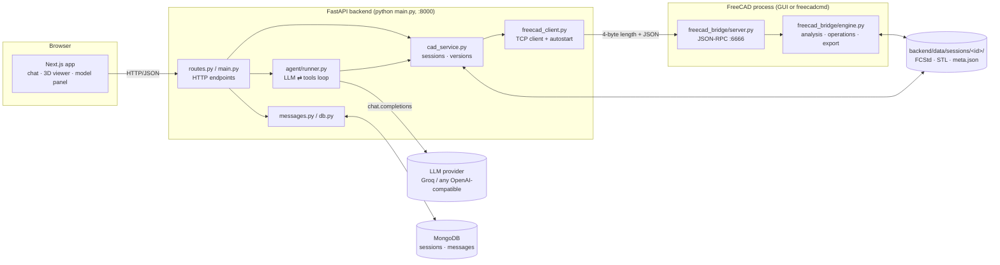
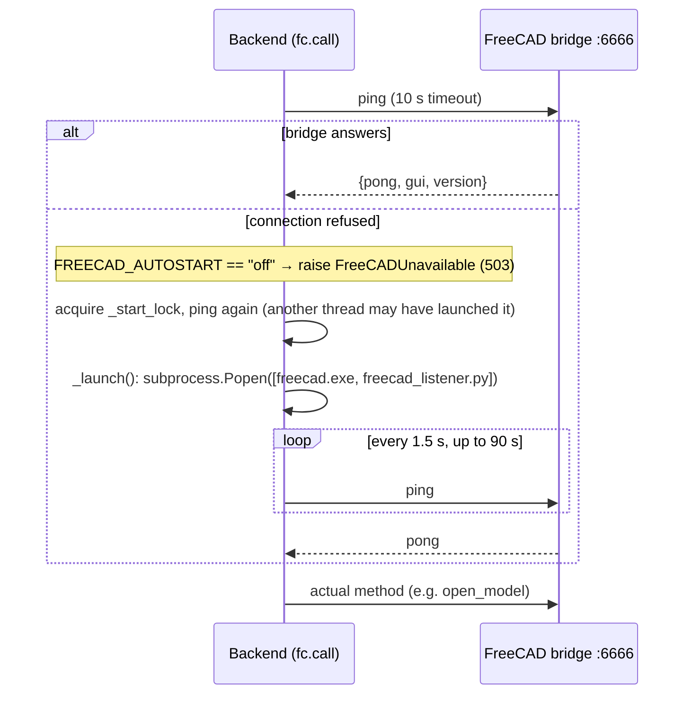
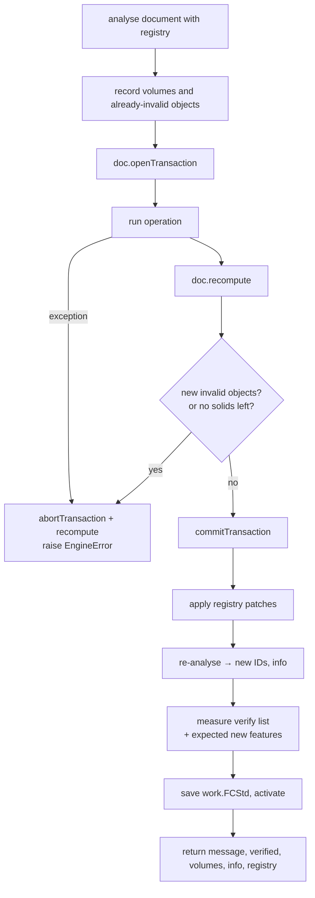
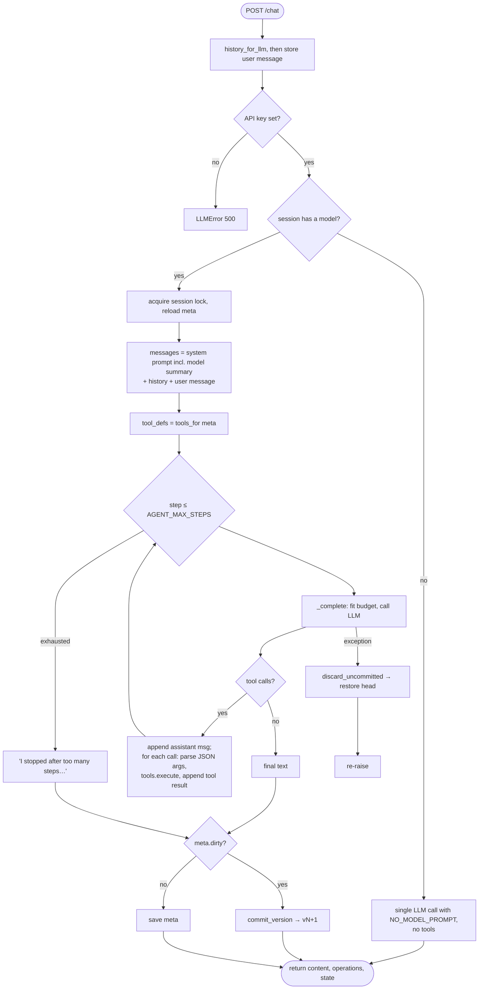
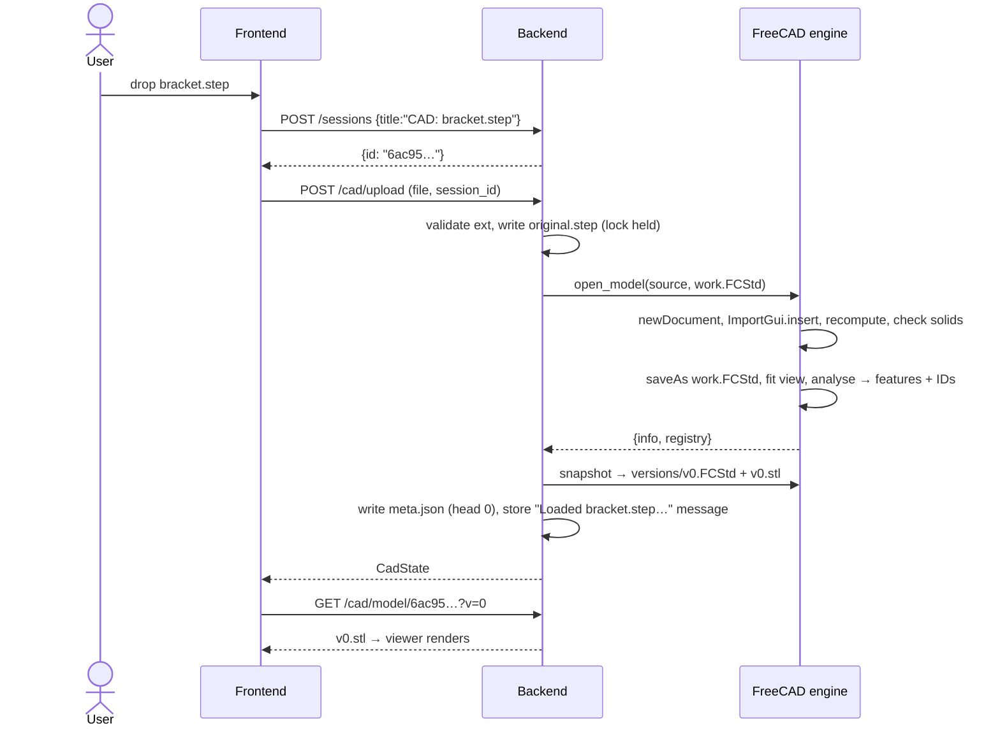
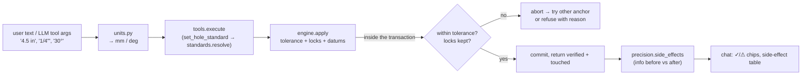

# AetherCAD: Technical Documentation

This document explains how AetherCAD works from end to end: every process, module, algorithm, data
structure and HTTP endpoint, and how a chat message turns into a verified geometry edit inside FreeCAD.
It describes the code as it exists in this repository. For setup instructions see the
[README](../README.md); for the original design rationale see [PLAN.md](PLAN.md).

## Contents

1. [What AetherCAD does](#1-what-aethercad-does)
2. [System architecture](#2-system-architecture)
3. [Repository map](#3-repository-map)
4. [Startup and process lifecycle](#4-startup-and-process-lifecycle)
5. [The FreeCAD bridge (RPC layer)](#5-the-freecad-bridge-rpc-layer)
6. [The engine: documents and objects](#6-the-engine-documents-and-objects)
7. [Feature recognition](#7-feature-recognition)
8. [Stable feature IDs](#8-stable-feature-ids)
9. [Edit operations](#9-edit-operations)
10. [Transactions, validation and verification](#10-transactions-validation-and-verification)
11. [Backend services](#11-backend-services)
12. [The AI agent](#12-the-ai-agent)
13. [HTTP API reference](#13-http-api-reference)
14. [Frontend](#14-frontend)
15. [End-to-end walkthroughs](#15-end-to-end-walkthroughs)
16. [Data model reference](#16-data-model-reference)
17. [Configuration reference](#17-configuration-reference)
18. [Troubleshooting](#18-troubleshooting)
19. [Known limitations and technical debt](#19-known-limitations-and-technical-debt)
20. [Extending AetherCAD](#20-extending-aethercad)
21. [Glossary](#21-glossary)
22. [Precision layer (Phase 1): units, tolerance, side effects, locks, datums, standards](#22-precision-layer-phase-1)
23. [Feature recognition (Phase 2): slots, pockets, chamfers, edges, threads, wall thickness](#23-feature-recognition-phase-2)

---

## 1. What AetherCAD does

AetherCAD is a conversational CAD editor. A user uploads an existing solid model (STEP, IGES, BREP or
FreeCAD `.FCStd`) and then talks to it:

- **Questions**: "How thick is the plate?", "List the holes", "Distance between H2 and H4?"
- **Edits**: "Make the 6 mm holes 8 mm", "Make it 120 mm long", "Fillet the vertical edges R5",
  "Set the pad length to 25".

The core design decisions:

| Decision | Why |
|---|---|
| **FreeCAD is the only geometry kernel and the source of truth.** | All geometry lives in a real FreeCAD document per session. The web app never computes geometry itself. |
| **The LLM calls typed tools with exact numbers, not free-form code.** | Deterministic Python inside FreeCAD performs the edit, so results are reproducible and checkable. |
| **Features get stable IDs (`H3`, `P1`…) matched by geometry.** | The LLM and the user can refer to "H3" and it means the same hole across edits. |
| **Every edit is transactional and verified.** | Failed or invalid edits are rolled back; successful ones are re-measured and reported. |
| **Every turn that changes geometry is a version.** | Undo/redo restores exact snapshots in FreeCAD and the viewer. |

---

## 2. System architecture



### Processes and ports

| Process | Started by | Port | Role |
|---|---|---|---|
| Next.js dev server | `npm run dev` in `frontend/` | 3000 | Serves the UI (no login: single-user local app) |
| FastAPI (Uvicorn) | `python main.py` in `backend/` | 8000 | HTTP API, LLM agent, session store |
| FreeCAD + bridge | Auto-launched by the backend, or by running `freecad_listener.py` | 6666 (localhost only) | Geometry kernel; executes engine methods |
| MongoDB | External (e.g. Atlas) | — | Optional persistence of sessions and chat |
| LLM provider | External | — | Groq by default (`openai/gpt-oss-120b`) |

The browser only talks to the backend; there is no login (single-user local app). The backend is the only
client of FreeCAD and of the LLM.

---

## 3. Repository map

```
Major_Project/
├── README.md                     Quick start
├── docs/
│   ├── ARCHITECTURE.md           This document
│   └── PLAN.md                   Original rebuild plan and roadmap
├── backend/
│   ├── main.py                   FastAPI app object, lifespan, middleware, CORS, entry point
│   ├── freecad_listener.py       Macro to run inside the FreeCAD GUI; starts the bridge
│   ├── requirements.txt          fastapi, uvicorn, openai, pydantic, python-dotenv, motor, pymongo…
│   ├── .env.example              Configuration template (copy to .env)
│   ├── app/
│   │   ├── sessions.py           /sessions endpoints + session lookup
│   │   ├── routes.py             /freecad/status, /cad/*, /chat endpoints + error mapping
│   │   ├── cad_service.py        Per-session folders, meta.json, locks, versions, undo/redo, export
│   │   ├── freecad_client.py     JSON-RPC client, FreeCAD executable discovery and auto-launch
│   │   ├── messages.py           Chat message persistence + history for the LLM
│   │   ├── db.py                 MongoDB connection with in-memory fallback
│   │   ├── units.py              Unit parsing / formatting shared by the fast path and tool arguments (§22.1)
│   │   ├── standards.py          ISO hole-size tables: resolve requests, name recognised holes (§22.6)
│   │   ├── precision.py          Session settings, side-effect report, verification display (§22.2–22.3)
│   │   └── agent/
│   │       ├── runner.py         One chat turn: LLM ⇄ tool loop, budget, retries, commit
│   │       ├── prompt.py         System prompt text and compact model summary
│   │       └── tools.py          Tool JSON schemas and the tool executor
│   ├── freecad_bridge/           Code that runs INSIDE FreeCAD's Python
│   │   ├── server.py             Socket server, framing, GUI-thread marshalling
│   │   ├── engine.py             Feature recognition, ID registry, operations, verification, export
│   │   └── headless.py           Entry point for `freecadcmd`
│   └── data/sessions/<id>/       Runtime data (created on upload; not in git)
└── frontend/
    ├── next.config.ts            Dev origins, server-action body limit
    └── src/
        ├── app/
        │   ├── layout.tsx        ThemeProvider, fonts
        │   └── page.tsx          Main page: chat, upload, undo/redo, 3D workspace, selection
        ├── lib/units.tsx              Display-unit context: formats mm/deg in the session unit (§22.8)
        ├── components/
        │   ├── cad/SettingsBar.tsx    Display unit, decimals and tolerance of the session
        │   ├── chat/ChatMessage.tsx   Message bubble + operation cards with verified values
        │   ├── chat/ChatInput.tsx     Textarea, attach button, suggestions
        │   ├── cad/CADViewer.tsx      React Three Fiber STL viewer (Z-up)
        │   ├── cad/ModelPanel.tsx     Size, parts, features, dimensions, parameters, version history
        │   ├── cad/SelectionInspector.tsx  Data + quick-edit buttons for the selected components
        │   └── ui/Sidebar.tsx         Session list, rename, new chat
        ├── hooks/useCADSession.ts     CAD state, upload, undo/redo, FreeCAD status polling
        ├── lib/api.ts                 Backend URL, fetch helpers with readable errors
        └── types/                     cad.ts, chat.ts: TypeScript mirrors of backend JSON
```

---

## 4. Startup and process lifecycle

### 4.1 Backend startup (`backend/main.py`)

1. `load_dotenv()` runs **before** any `app.*` import, because those modules read environment variables
   at import time (`LLM_MODEL`, `FREECAD_AUTOSTART`, budgets…).
2. The FastAPI app is created. Middleware order matters:
   - `_json_errors` (HTTP middleware) catches any unexpected exception, prints the traceback and returns
     `500 {"detail": "Server error: <Type>: <msg>"}`. It is registered **before** CORS so that it sits
     *inside* CORS, so even crash responses carry CORS headers and the browser shows the real message
     instead of "Failed to fetch".
   - `CORSMiddleware` allows `http://localhost:3000`, `http://127.0.0.1:3000` and `http://192.168.x.x:3000`.
3. `app.include_router(sessions.router)` and `app.include_router(router)` add the session and CAD/chat routes;
   `install_error_handlers(app)` maps domain errors to HTTP statuses (see [§13.4](#134-error-mapping)).
4. In the `lifespan` handler (FastAPI's replacement for `on_event("startup")`), `init_db()` connects to MongoDB (5 s timeout + ping). On failure it prints a
   warning and the app keeps running with in-memory storage.
5. `uvicorn.run("main:app", reload=True, reload_excludes=["data/*", "freecad_bridge/*"])`: the auto-reloader
   restarts on `.py` changes but **not** when session data is written, which would otherwise kill requests
   mid-flight. It also does not watch `.env`, so restart manually after changing configuration.

### 4.2 FreeCAD startup (`backend/app/freecad_client.py`)

FreeCAD is started lazily: nothing happens until the first call that needs geometry.



- **Executable discovery** (`_find_exe`): an explicit env var (`FREECAD_GUI_EXE` / `FREECAD_CMD_EXE`) wins;
  otherwise it searches `%ProgramFiles%\FreeCAD*\bin\` and `%LOCALAPPDATA%\FreeCAD*\bin\` (newest folder
  first), then `PATH` (Linux/macOS).
- **Modes**:
  - `gui` (default): launches `freecad.exe backend/freecad_listener.py`. You see the FreeCAD window and every
    edit happens visibly in it.
  - `headless`: launches `freecadcmd backend/freecad_bridge/headless.py`. No window.
  - `off`: never launches; you must start FreeCAD and run the listener yourself.
- `status()` (used by `/freecad/status`) only pings. It never launches FreeCAD.

### 4.3 Frontend startup

`npm run dev` starts Next.js. There is no middleware and no login.

---

## 5. The FreeCAD bridge (RPC layer)

### 5.1 Wire protocol

Both directions use the same framing: a **4-byte big-endian unsigned length**, then that many bytes of
**UTF-8 JSON**.

```
request : {"id": 7, "method": "apply", "params": {"session_id": "...", "op": "resize_hole", ...}}
response: {"id": 7, "ok": true,  "result": {...}}
        | {"id": 7, "ok": false, "error": "H9 is a plane, expected hole", "traceback": "..."}
```

- One TCP connection per call (`freecad_client.call_sync`): connect with 5 s timeout, send, read exactly
  4 bytes, then exactly *length* bytes (`_recv_exact` loops until complete, so large payloads are never
  truncated), close.
- Default per-call read timeout is 300 s; a timeout becomes `FreeCADError("did not answer within …")`.
- `ok: false` is raised as `FreeCADError(message, traceback)`. Connection failures raise
  `FreeCADUnavailable`.
- The async wrapper `call()` runs `ensure_running` and `call_sync` in Starlette's thread pool so the event
  loop is never blocked by socket I/O.

### 5.2 Server inside FreeCAD (`freecad_bridge/server.py`)

FreeCAD's document API is **not thread-safe** and must be used from the Qt main thread in GUI mode.

**GUI mode** (`start_gui()`, called by `freecad_listener.py`):

```mermaid
sequenceDiagram
    participant Sock as Socket thread (per connection)
    participant Q as queue.Queue
    participant Main as Qt main thread (QTimer every 50 ms)
    participant Eng as engine.dispatch
    Sock->>Sock: read_msg(conn)
    Sock->>Q: put((request, Event, holder))
    Sock->>Sock: Event.wait(600 s)
    Main->>Q: get_nowait()
    Main->>Eng: handle(request)
    Eng-->>Main: response dict
    Main->>Sock: holder["resp"] = response; Event.set()
    Sock->>Sock: write_msg(conn, response)
```

- An accept loop runs on a daemon thread; each connection gets its own thread.
- A `QTimer` on the main thread drains the queue every 50 ms and runs requests **sequentially**, so all
  FreeCAD calls happen on the main thread, one at a time.
- If the main thread doesn't answer within 600 s the socket thread replies with an error.
- The timer object is stored in `_state` so Python doesn't garbage-collect it.
- PySide import falls back `PySide` → `PySide6` → `PySide2`.

**Headless mode** (`serve_forever()`, via `headless.py`): a plain sequential accept → read → handle →
write loop on the calling thread.

**Hot reload**: running `freecad_listener.py` again while the bridge is up calls
`importlib.reload(engine)`, so you can edit `engine.py` without restarting FreeCAD. The RPC method
`reload_engine` does the same remotely.

`handle()` dispatches to `engine.dispatch(method, params)`, which looks up `METHODS` and converts
`EngineError` to `{"ok": false, "error": msg}` (expected, user-facing) and any other exception to an error
with a traceback (unexpected; also printed to FreeCAD's report view).

### 5.3 RPC methods (`engine.METHODS`)

| Method | Params | Returns | Purpose |
|---|---|---|---|
| `ping` | — | `{pong, gui, version}` | Health check |
| `open_model` | `session_id, source_path, work_path, registry?` | `{info, registry}` | Import the uploaded file into a new document, save as `work.FCStd`, analyse |
| `reload` | `session_id, work_path, registry?, datums?` | `{info, registry}` | Close and re-open `work.FCStd` (after undo/redo) |
| `model_info` | `session_id, work_path, registry?, datums?` | `{info, registry, manual_edit}` | Re-analyse the current document; `manual_edit` = the user changed the geometry by hand in FreeCAD (§11.7) |
| `apply` | `session_id, work_path, op, params, registry, tolerance?, locks?, datums?` | `{message, verified, touched, volume_before, volume_after, info, registry, lock_resolution?}` | Run one edit operation transactionally; tolerance and locks are checked before commit (§22) |
| `evaluate_locks` | `session_id, work_path, locks, registry, datums?` | `{locks: [{…, value, unit}]}` | Current value of each lock target (used when a lock is created) |
| `find_edges` | `session_id, work_path, registry, feature?, object?, convexity?, kind?, near?, min_length?, limit?` | `{edges, total, registry}` | Edges with IDs (E#), §23.4 |
| `wall_thickness` | `session_id, work_path, registry, object?, threshold?, samples?` | `{parts: [{part, min_thickness, at, faces, thin}]}` | Minimum wall per part, §23.6 |
| `find_features` | `session_id, work_path, registry, kind?, diameter_min?, diameter_max?, normal?, near?, object?, limit?` | `{features, total, registry}` | Filtered/sorted feature query (`object` = name or label) |
| `dimensions` | `session_id, work_path, registry, object?, feature?, type?, limit?` | `{dimensions, total, patterns, registry}` | Driving dimensions (§7.9), filtered |
| `highlight` | `session_id, work_path, ids, registry, select?, zoom?` | `{meshes: [{id, kind, positions, indices}], missing, registry}` | Triangles of features / dimensions / patterns for the web viewer; selects them in the FreeCAD GUI |
| `pick` | `session_id, work_path, point, registry, mode?` | `{id, feature, part, face, distance, edge?, registry}` | The component under a point clicked in the web viewer (§8.4); `mode: "edge"` returns the nearest edge |
| `gui_selection` | `session_id, work_path, registry` | `{ids, gui, registry}` | What is selected in the FreeCAD window, as feature / part IDs (§8.4) |
| `show_window` | `session_id?, work_path?` | `{shown}` | Bring FreeCAD and the session document to the front |
| `measure` | `session_id, work_path, a, b, registry` | distances (see [§9.3](#93-query-methods)) | Measure between features, objects or points |
| `list_objects` | `session_id, work_path, registry, name_contains?` | `{objects, total, overall_bbox, registry}` | Every solid object, largest first, with parent assembly and bbox |
| `snapshot` | `session_id, work_path, fcstd_path, stl_path` | paths | Save, copy to `vN.FCStd`, mesh to `vN.stl` |
| `export` | `session_id, work_path, fmt, path` | `{path}` | Export STEP/IGES/BREP/STL/FCStd |
| `close_session` | `session_id, work_path?` | `{closed}` | Close the session's document |

---

## 6. The engine: documents and objects

`engine.py` runs inside FreeCAD's Python. It is **stateless apart from one map** `_DOCS: session_id → doc.Name`.
The feature-ID registry is owned by the backend and passed in on every call, so IDs survive a FreeCAD
restart.

### 6.1 Session documents

- `_find_doc(session_id, work_path)`: looks up `_DOCS`; if FreeCAD was restarted (map empty), it searches
  open documents whose `FileName` equals `work_path`.
- `_get_doc()`: if not open, re-opens `work.FCStd` from disk. Sets `UndoMode = 1` and activates the
  document. If neither the document nor the file exists, it raises *"Re-upload the model."*
- `_activate(doc, fit)`: in GUI mode, brings the document's MDI sub-window to the front and optionally sets
  an isometric view and fits it. GUI errors are caught and printed; they never break an edit.
- `_save(doc)`: saves and deletes the `*.FCBak` backup files FreeCAD writes next to the document.

### 6.2 Which objects count (`_solid_objects`)

An object is analysed and edited only if:

1. It is not a sketch (`Sketcher::*`), not a **container** (`App::Part`, `App::DocumentObjectGroup`,
   `App::Origin`, `App::Link`, `App::LinkGroup`), and has a `Shape`. In FreeCAD 1.0 an `App::Part` exposes the
   combined shape of its children; analysing it as well would report every feature twice.
2. It is not a child of a `PartDesign::Body` (the Body itself represents its features' final solid).
3. It is visible (and, if inside an `App::Part`, the part is visible too).
4. Its shape is non-null and contains at least one solid.

STEP assemblies imported with `ImportGui` usually produce one `Part::Feature` per part inside `App::Part`
containers; each part is analysed on its own and reports its container as `parent`. Containers can still be
targeted by name (e.g. `transform_object` on a whole sub-assembly). Mesh-only or surface-only files have no
solids and are rejected at upload.

### 6.3 Global coordinates (`_gshape`)

Objects inside an `App::Part` have placements relative to their parent. `_gshape(obj)` copies the shape and
pre-multiplies the parent's **global placement**, so every analysis, measurement and edit happens in one
global coordinate system (the one the user sees). When an edited shape is written back
(`_set_shape`), the inverse parent placement is applied so the object stays correctly placed in its
container.

### 6.4 Coordinate conventions

Millimetres and degrees. Axes: **X** left(−)/right(+), **Y** front(−)/back(+), **Z** bottom(−)/top(+).
The web viewer uses the same Z-up frame (see [§14.5](#145-3d-viewer-cadviewertsx)).

---

## 7. Feature recognition

`_features_of_shape(objname, shape)` turns a B-rep solid into a list of semantic features. It runs on
every analysis (upload, before and after each edit, queries).

### 7.1 Tolerances

```
diag = shape bounding-box diagonal
tol  = max(1e-3, diag × 1e-5)      # e.g. 1 m part → 0.01 mm
```

Most comparisons use `tol × 10`. Axis parallelism uses `|a·b| > 1 − 1e-7` (cylinders) or `1 − 1e-6`.

### 7.2 Face classification (pass 1)

Each face's underlying surface type decides what happens:

| Surface | Handling |
|---|---|
| `Part.Cylinder` | Collected into **cylinder groups** (see below) |
| `Part.Plane` | Collected as a plane candidate: normal at mid-parameter, centre of mass, area, offset `d = n·c`, bbox |
| `Part.Cone` | Collected as a cone candidate: canonical axis, axial range, max radius, semi-angle, apex |
| `Part.Sphere` | Immediately a **sphere** feature `S#` (radius, centre) |
| `Part.Toroid` | Immediately a **round** feature `R#` (minor radius = fillet radius; torus-shaped fillets) |
| anything else (B-spline etc.) | Ignored |

**Axis canonicalisation** (`_canon_axis`): an axis and its negation describe the same line, so the axis is
flipped until its first significant component is positive (z, then y, then x). Each axis line is
described by `base = point − axis·(point·axis)`, the point on the line closest to the origin.

**Cylinder grouping**: for each cylindrical face the engine computes:

- `concave`: whether the face normal points **towards** the axis (`n · radial < 0`). Concave = material
  outside the cylinder = **hole** wall. Convex = **boss**/shaft.
- the axial range `[t0, t1]` from the face's vertices projected on the axis,
- the angular span `|u1 − u0|`.

Faces with the same concavity, radius (±tol), parallel axis and same axis line are grouped (a full cylinder
is often split into two half-faces).

### 7.3 Holes, bosses and fillets (pass 2)

Inside each group, faces are sorted by `t0` and **clustered** along the axis when they touch or overlap.
For each cluster:

- **Partial cylinder** (total angular span < 98 % of 2π) → a **round** `R#` (a fillet or rounded edge), with
  radius, length, concavity, centre and axis.
- **Full concave cylinder** → a **hole** `H#`:
  1. **Caps** at each end (`_caps_at`): a perpendicular planar face whose centre is on the axis at that end
     and whose bbox is no wider than the hole (the flat bottom of a blind hole), or a *narrowing* cone on the
     same axis touching that end (a **drill tip**).
  2. **Open end**: no cap **and** a probe point just beyond the end (`eps = max(20·tol, 0.01)`) is *not*
     inside the solid.
  3. `through = open0 and open1`.
  4. **Entry**: the open end (the top end `t1` is preferred). `direction` points from the entry into the
     material.
  5. **Countersinks** (`_countersink_at`): a *widening* cone on the same axis at an open end. It records the
     outer diameter, included angle (2 × semi-angle) and position.
  6. Output: `diameter, radius, depth (t1−t0), through, drill_tip, entry, direction, center, position,
     countersinks`. Internal fields keep face indices, caps, open flags and countersink geometry for edits.
- **Full convex cylinder** → a **boss** `C#`: planar caps at its ends are marked used. The **free end** is
  the end with air beyond it (probe point outside the solid); the other is the **base end** where it joins
  the body.

Planes and cones consumed as caps or countersinks are marked used so they aren't reported twice.

### 7.4 Cones and planes (pass 3)

- Remaining cones become **cone** features `K#` (half-angle, apex, axis, centre, length). These are typically
  chamfers or tapers.
- Every plane becomes a **plane** feature `P#` with `normal, center, area, bbox` and a **label**
  (`_plane_label`):
  - Normal along ±Z/±X/±Y and at the object's bounding-box extreme → `"top face (+Z, outermost)"`,
    `"left face (-X, outermost)"`, etc.
  - Axis-aligned but not at the extreme → `"faces +Z at z=12.5"`.
  - Otherwise → `"inclined face"`.
  - Planes that are hole bottoms carry `is_cap: true`. The UI and LLM summary hide them.

### 7.5 Semantic positions

Holes and bosses get a human-readable `position` from their centre's location within the object's bounding
box: below 25 % of the span on an axis → `left(-X)`/`front(-Y)`/`bottom(-Z)`; above 75 % → the opposite;
otherwise nothing. Example: `"right(+X) back(+Y)"`, or `"central"`.

### 7.6 Parametric information (`_parametric_info`)

For `.FCStd` files the engine also reports:

- **Parametric objects** (`PartDesign::*` and `Part::*` except plain `Part::Feature`): numeric, boolean and
  enum properties (lengths, angles, counts…), skipping placement/attachment/base groups, plus any
  **expressions** (`ExpressionEngine`) that drive properties.
- **Sketches**: dimensional constraints (`Distance`, `DistanceX`, `DistanceY`, `Radius`, `Diameter`,
  `Angle`), with index, name, value (angles in degrees) and whether they are driving.
- **Spreadsheets**: used cells with alias and value (up to 200).

`is_parametric` is true when there are parametric objects or sketches.

### 7.7a B-spline and other non-analytic faces (`analysis.surface_info`)

Some exporters write every face as a B-spline. `surface_info` reads analytic surfaces directly and otherwise
fits one: `Face.findPlane` for planes; for the rest it samples a 9×9 grid of points and normals inside the
face and fits with numpy:

- **sphere**: all normal lines meet in one point (least squares), with constant radius;
- **cylinder**: normals are perpendicular to the axis, so the axis is the eigenvector of `NᵀN` with eigenvalue ≈ 0;
  the axis position is where the normal lines' projections meet; the radius must be constant;
- **cone**: normals make a constant angle with the axis (`N·a = const`); radius is linear along the axis.

A fit is accepted when its residual is below `max(10·tol, 1e-4)`. The angular span of a fitted cylinder
(full hole vs partial fillet) is measured from points on its boundary. Faces that match nothing are counted
per object as `unrecognized_faces`, so the UI can say the parse is incomplete.

Every face that no rule classifies becomes a **free-form face feature** (`kind: "face"`, ID `F#`, with
`surface`, `area`, `center`, `position`), so every face of every part has exactly one ID (checked by the test
suite on all fixtures). It is still counted in `unrecognized_faces`.

### 7.7b Countersinks and counterbores

A countersink's depth and entry now include the cone: a Ø5 hole with a 90° Ø10 countersink in a 10 mm plate
reports `depth 10` and its entry on the top face. A **counterbore** is a larger blind, flat-bottomed hole whose
floor meets an open end of a smaller coaxial hole (`analysis.link_counterbores`). The smaller hole gets
`counterbore: {diameter, depth, feature}` and its entry/depth cover the whole stack; the larger keeps its own ID
with `counterbore_of`. Moving a hole moves its counterbore; resizing it refuses a size larger than its counterbore.

### 7.8 Hole patterns (`analysis.hole_patterns`)

Holes are grouped by object, diameter, axis, through/depth and entry plane. Groups of ≥ 3 are tested, in order:

| Pattern | Test | Reported |
|---|---|---|
| `circular` | centres fit a circle (algebraic fit, residual < 10·tol) with equal angular steps (full circle or arc) | `pcd, count, angle_step_deg, start_angle_deg, full_circle, center, axis, ref_dir` |
| `grid` | centres form a complete `nu × nv` grid along the in-plane axes with uniform spacing | `count_u, count_v, spacing_u, spacing_v, dir_u, dir_v, center` |
| `linear` | centres are collinear with uniform spacing | `spacing, count, direction, start` |

Patterns get IDs `PAT1…` (ordered by their first hole) and each member hole carries `pattern`.

### 7.9 Driving dimensions (`analysis.dimensions`)

The dimension layer is what lets a request like "make it 120 long" become one exact operation. Per object:

- **Plane pairs with opposite normals.** For each face, the nearest opposite face whose projection overlaps it
  (a point on face A whose projection lands on face B) is found on each side. The midpoint between them is
  probed: inside material → `thickness`, in air → `gap` (slot / pocket width).
- **Overall sizes** (`extent`): the largest outermost faces at the bounding-box limits on X, Y and Z.
- **Hole positions** (`edge_distance`): for each hole, the nearest face parallel to its axis on the material side,
  one per direction, provided the hole's projection lands on that face.

- **Hole to hole** (`center_distance`, Phase 1): each hole's nearest parallel neighbour(s) (ties kept, so every bolt
  hole has both neighbours), `H1-H2`.
- **Coaxiality** (`coaxial`): parallel holes whose axes are closer than the smaller radius, `H1◎H2`, value = axis offset.
- **Angles** (`angle`): adjacent planar faces that are neither parallel nor square, `P3∠P7`, value = included angle in
  degrees (`unit: "deg"`; 90° = square corner, 135° = a 45° chamfer next to its face).
- **Radial** (`diameter` / `radius`): boss diameters `C1.Ø`, fillet and sphere radii `R2.R`.

Each dimension is `{id, type, value, refs, axis, object, label, unit?}` where `id` is built from the feature IDs, e.g.
`P5-P6` or `H3-P5` (lower coordinate first for plane pairs). A hole midway between two parallel faces always refers to
the lower-numbered face, so edge-distance IDs don't flip between analyses. Because the IDs are stable, dimension IDs are too. Dimensions
are computed lazily and cost ~0.25 s for a 30-part assembly.

### 7.10 Model info structure (`_model_info`)

```json
{
  "units": "mm",
  "document": "bracket",
  "objects": [{"name": "Part__Feature", "label": "Bracket", "type": "Part::Feature", "parent": "Assembly",
               "volume": 41250.0, "area": 9800.0, "solids": 1, "faces": 22, "edges": 60,
               "bbox": {"min": [...], "max": [...], "size": [...]}, "center_of_mass": [...]}],
  "bbox": {"min": [...], "max": [...], "size": [100, 60, 10]},
  "features": {"hole": [...], "boss": [...], "round": [...], "plane": [...], "cone": [...], "sphere": [...]},
  "counts": {"hole": 4, "plane": 10, "round": 4},
  "patterns": [{"id": "PAT1", "type": "grid", "holes": ["H1", "H2", "H3", "H4"], "spacing_u": 80, "spacing_v": 40, "...": "..."}],
  "dimensions": [{"id": "P5-P6", "type": "extent", "value": 100.0, "refs": ["P5", "P6"], "label": "overall X size"}],
  "parametric": [...], "sketches": [...], "spreadsheets": [...],
  "is_parametric": false
}
```

`parent` (label of the containing `App::Part`) is present only for parts inside an assembly.
Each feature in `features` is the public form (internal `_` keys stripped) plus `object` (owner name).
Lists are sorted by ID number.

---

## 8. Stable feature IDs

The geometry changes after every edit and FreeCAD's face indices are renumbered, so IDs cannot be face
indices. Instead the backend keeps a **registry** of geometric descriptors and the engine re-matches
features against it on every analysis.

### 8.1 Registry format

```json
{
  "items": {
    "H1": {"k": "hole",  "a": [0,0,1], "b": [20,15,0], "t": [0,10], "r": 3.0},
    "P1": {"k": "plane", "n": [0,0,1], "d": 10.0, "c": [50,30,10]},
    "S1": {"k": "sphere", "c": [0,0,5], "r": 4.0}
  },
  "next": {"H": 5, "P": 11, "R": 5}
}
```

- Axial features (hole, boss, round, cone): axis `a`, axis-line base point `b`, axial range `t`, radius `r`.
- Planes: normal `n`, offset `d = n·c`, centre `c`.
- Spheres: centre `c`, radius `r`.
- `next` holds the next number per prefix. **Numbers are never reused**, so a removed `H2` stays gone and a
  new hole becomes `H5`, not `H2`.

- Free-form faces (`F#`): centre `c` and area; matched when the centre is within 10·tol and the area within 0.1 %.
- `parts` maps each solid object's FreeCAD name to its **part ID** `B#` (`next["B"]`). Object names never
  change inside a document, so part IDs are stable across edits; deleted parts' IDs are not reused. Every
  feature carries `part`, `objects[]` carry `id`, and any `object` parameter (tools, `find_features`,
  `dimensions`) accepts a part ID.

The registry is stored in `meta.json` by the backend and sent with every RPC call.

### 8.2 Matching (`_match_score`, `_assign_ids`)

For every (new feature, registry entry) pair of the same kind, a score is computed (lower is better;
`None` = incompatible):

| Kind | Compatible when | Score |
|---|---|---|
| plane | same normal direction (`n·n' > 1−1e-6`) and same offset (±10·tol) | distance between centres |
| sphere | centres within 10·tol | centre distance |
| axial | parallel axes, same axis line (±10·tol), overlapping axial ranges | `|Δr| + 0.001·(|Δt0| + |Δt1|)` |

All compatible pairs are sorted by score and assigned **greedily** (each feature and each ID used at most
once). Unmatched features get fresh IDs in a deterministic order: by kind, then larger area first, then
higher Z, then X, then Y.

### 8.3 Expected-geometry patches

Some operations change exactly the properties used for matching, so before re-analysis the operation
writes a patch into the registry describing the *expected* new geometry:

| Operation | Patch | Effect |
|---|---|---|
| `resize_hole` | `r = new_radius` | The resized hole keeps its ID |
| `move_hole` | `b = new axis base` | The moved hole keeps its ID |
| `push_pull_face` / `set_face_distance` | `d` and `c` shifted by the distance | The moved face keeps its ID |

---

## 9. Edit operations

All operations live in `engine.OPS` and receive a context `_Ctx` with the document, the current feature map
and the registry. `ctx.feature(id, kinds)` resolves an ID (case-insensitive) and type-checks it; unknown IDs
produce *"Unknown feature id … Use get_model_info / find_features"* so the LLM can recover.

### 9.1 How B-rep edits are written back (`_set_shape`)

1. **Clean**: `removeSplitter()` merges coplanar faces left by booleans; a compound with one solid is
   unwrapped.
2. **Validate**: empty shape or no solids → error. Invalid shape → try `fix()`; still invalid → error
   ("rolled back").
3. **Target**: if the object is a plain `Part::Feature`, its `Shape` is replaced in place. If it is
   parametric (e.g. a PartDesign Body), a new `Part::Feature` named `AIEdit` (label `"<label> (edited)"`) is
   created with the result, the original is hidden, and its colour is copied. `apply()` detects this and adds
   a note to the operation message (*"…replaces a parametric object with a plain solid; that object's
   parameters no longer drive the shown geometry"*), so the LLM tells the user.
4. **Placement**: converts the global-coordinate result back into the parent container's local frame.
5. **Audit log**: appends a note to the object's `AiEdits` string-list property (group "AetherCAD"), so the
   FCStd records what AetherCAD did.

### 9.2 Operation reference

| Operation | Parameters | Algorithm |
|---|---|---|
| `resize_hole` | `hole`, `diameter` | **Fill** the old hole (`_fill_hole`), then **cut** a new cylinder of the new diameter on the same axis and axial range. Open ends are extended by a margin (`max(2 % of diag, 1 mm)`) so the cut fully clears. A blind hole with a drill tip gets a new tip cone with the same angle; countersinks are recreated with the same outer diameter and angle. |
| `move_hole` | `hole`, `offset`, `to` or `to_datum` | Only the component **perpendicular** to the hole axis is used (a hole can't move along its own axis). `to_datum: {B: 15, C: 20}` places the axis at those distances from the datum faces (§22.5). Fill the old hole, cut an identical one (tip, countersinks) on the shifted axis. |
| `add_holes` | `face` (plane), `diameter`, `positions?`, `depth?` | A position is `[x,y,z]`, `[u,v]` on an axis-aligned face, or datum distances `{B: 15, C: 20}`. Each position is projected onto the face plane and must lie inside the face. A cylinder starts a margin above the face and goes along −normal: through (depth = 2 × diag) or blind (given depth). No positions → face centre. Multiple holes are cut in one boolean. |
| `remove_features` | `features[]` | Groups by object, then calls OpenCASCADE **defeaturing** on all the feature's faces (walls, caps, countersink cones, slot / pocket walls and floor, chamfer face). If defeaturing changes nothing or yields an invalid shape: a single hole, slot or pocket is plugged exactly; otherwise it errors with "try removing them one at a time". |
| `edit_slot` | `slot`, `width?`, `length?`, `depth?`, `offset?` / `to?` / `to_datum?` | Fuses an exact plug of the slot (its obround / rectangular outline × depth), cuts the new slot from the same opening (extended through for through slots). Refuses a blind depth that would break through. §23.2 |
| `edit_pocket` | `pocket`, `depth?` or `corner_radius?` | Depth: moves the floor like `push_pull_face` (holes in the floor keep their depth below it). Corner radius: removes the corner rounds by defeaturing and fillets the vertical wall-to-wall edges (0 = sharp). §23.2 |
| `edit_chamfer` | `chamfer`, `size?` or `to_fillet?` | Removes the chamfer face by defeaturing (sharp edge back), then chamfers or fillets that edge. §23.3 |
| `set_dimension` | `dimension` (e.g. `"P5-P6"`, `"H3-P5"`, `"H1-H2"`, `"P3∠P7"`, `"C1.Ø"`, `"R2.R"`, `"H1◎H2"`), `value`, `anchor?` | Plane–plane: moves the faces so the distance is exact; `anchor` = `start` (first ID stays, default), `end` (second stays) or `symmetric`. Hole–plane: moves the hole (and its counterbore) along the face normal. Hole–hole: moves the holes along the line joining them; value 0 makes them coaxial. **Non-parallel planes** (or `∠`): rotates one face about the straight edge it shares with the other (anchor start: the second rotates) — the swept wedge, bounded by the face's flat convex neighbours, is fused or cut. **`.Ø` / `.R`**: holes are re-cut, bosses grown (fuse a tube) or shrunk (cut a tube), cylindrical fillets removed by defeaturing and re-made on the restored edge. Verified by re-measuring the dimension. |
| `set_hole_profile` | `hole`, `diameter?`, `counterbore_diameter?`, `counterbore_depth?`, `countersink_diameter?`, `countersink_angle?`, `remove_counterbore?`, `remove_countersink?`, `note?` | Fills the hole (and its counterbore/countersinks) and re-cuts it on the same axis with the same far end (through / blind depth / drill tip) and entry face, with the requested counterbore or countersink. Unspecified parts are kept. Used by `set_hole_standard`. Every requested size is verified. |
| `edit_hole_pattern` | `pattern`, `pcd?`, `count?`, `start_angle?`, `spacing?`, `spacing_u?`, `spacing_v?`, `count_u?`, `count_v?`, `anchor?` | Computes the new hole positions (`analysis.pattern_positions`), fills all holes in one defeaturing pass and re-cuts them (tips, countersinks, counterbores kept). Count changes keep the surviving IDs; grids change their counts with `count_u` / `count_v` about the same centre. Verified by re-detecting the pattern. |
| `push_pull_face` | `face`, `distance` | Extrudes the planar face along its outward normal by `distance` into a prism; **fuse** if positive (adds material), **cut** if negative (removes). Holes, countersinks and counterbores that open on the face are re-cut relative to its new position, so blind features keep their depth below it and through holes just get longer. Since Phase 2: cylindrical fillets running along the face's edges are lifted and re-made at the new corner, and pushing out fills the footprints of bosses standing on the face (§23.7). |
| `set_face_distance` | `face`, `reference_face`, `distance` | Faces must be parallel. Computes the current signed distance along `face`'s normal and push/pulls `face` by the difference, so the distance becomes exact. The reference stays fixed. Used for "make it 120 mm long". |
| `fillet_edges` | `radius`, `edges[]`, `object?` | Resolves edges via selectors (below), keeps only **sharp** edges, calls `makeFillet`. Verification expects a new round with that radius. |
| `chamfer_edges` | `size`, `edges[]`, `object?` | Same selection; `makeChamfer` with equal distance. |
| `add_primitive` | `shape`, `dimensions`, `position`, `direction?`, `operation?`, `object?` | Builds a box (centred on `position`, L×W×H along X/Y/Z, optionally rotated so its Z aligns with `direction`), cylinder (base centre at `position`, along `direction`), cone, sphere (centre) or torus. Then `fuse` / `cut` / `common` with the target object, `replace` to swap the target object's whole shape for the primitive (the object keeps its name, label, colour and assembly membership; used for "make the rectangular top round"), or `new` to create a separate object. |
| `transform_object` | `object?`, `translate?`, `rotate?{axis, angle, center?}` | Composes a new `Placement`: rotation about `center` (default: bbox centre), then translation. |
| `scale_object` | `factor` (number or `[sx,sy,sz]`), `object?`, `center?` | Uniform scale via `shape.scale`, or non-uniform via a matrix and `transformGeometry`, about `center` (default: bbox centre). |
| `set_property` | `object`, `property`, `value` | Refuses if the property is driven by an expression (*"change its source instead"*). Sets it and verifies the new value. |
| `set_sketch_constraint` | `sketch`, `constraint` (name or index), `value` | Only driving dimensional constraints. Sets with units (`mm` or `deg`) via `setDatum`; the solver and recompute update the model. |
| `set_spreadsheet_cell` | `sheet`, `cell` (address or alias), `value` | Resolves aliases to addresses and sets the cell. |
| `delete_object` | `object` | Refuses if other objects depend on it (`InList`). Membership in a container's `Group` (an `App::Part`, group or Body) is not counted as a dependency, so parts inside assemblies can be deleted. |
| `run_python` (tool: `run_freecad_python`) | `code`, `description` | **Disabled unless `AGENT_ALLOW_PYTHON=1`** (the tool is then not even offered to the LLM). Executes code with `doc`, `App`, `Part`, `V` in scope; stdout (last 2,000 chars) is returned. Still runs inside the transaction, so errors roll back. |

**Edge selectors** (`_select_edges`), combinable in one object and passed as a list:

| Selector | Meaning |
|---|---|
| `{face: "P3"}` | All edges of face P3 |
| `{between: ["P1","P5"]}` | The edge(s) shared by two faces |
| `{hole: "H2", end: "entry"\|"exit"\|"both"}` | Circular rim edges of a hole (entry = open side it's drilled from) |
| `{boss: "C1", end: "free"\|"base"\|"both"}` | Rim edges of a boss (free = tip, base = junction with body) |
| `{parallel_to: "Z", on_face?: "P2"}` | Straight edges parallel to an axis, optionally only those on a face |
| `{all: true}` | Every edge |

Afterwards edges are de-duplicated (`isSame`) and filtered with `_is_sharp`: seam edges and tangent edges
(normals of the two adjacent faces within 1°) can't be filleted and are dropped.

When `object` isn't given, the target object is inferred from the first selector's feature; if that's not
possible and the document has exactly one solid it is used, otherwise the engine asks for `object` and lists
candidates.

### 9.3 Query methods

- **`find_features`** filters by kind, diameter range, plane normal (`+Z`, `-X`…) and object; sorts by
  distance to `near` if given, else by ID; returns at most `limit` (default 50) plus the total count.
- **`measure(a, b)`**: each reference may be a feature ID (its faces), an object name/label (its whole
  shape) or an `[x,y,z]` point. Returns:
  - `min_distance` and up to 2 pairs of closest points (OpenCASCADE `distToShape`);
  - for two parallel axial features: `axis_to_axis_distance`;
  - for two parallel planes: `plane_to_plane_distance`;
  - for two features: `center_delta` and `center_distance`.

---

## 10. Transactions, validation and verification

`engine.apply()` wraps every edit:



- A `TypeError` from wrong arguments becomes *"Bad parameters for <op>: …"* so the LLM can correct the call.
- **Verification** (`_measure_field`) re-measures, after re-analysis, the values the operation promised:

| Operation | Verified |
|---|---|
| `resize_hole` | the hole's new `diameter` |
| `move_hole` | the hole's new `center` |
| `set_face_distance` | the actual plane-to-plane distance |
| `set_property` | the property value read back |
| `set_sketch_constraint` | the constraint value read back |
| `fillet_edges` | at least one *new* round with that radius exists |

  A verification entry has `status: "ok"` with the measured `value`, or `status: "missing"` with a note (for
  example the feature merged into another). Since Phase 1 every entry with a target also carries
  `requested, achieved, deviation, within_tolerance, unit`, the check happens **before** the transaction is
  committed, and more operations are verified (push/pull offset, pattern values, new holes, datum distances,
  translations, scaling, removals, property values); see §22.2. The UI shows ✓ chips and ⚠ warnings accordingly, and the system
  prompt tells the LLM to call a value "verified" only when it appears here.
- `volume_before` / `volume_after` per object are returned for every edit, so the effect of any change
  (including custom scripts) is visible.

---

## 11. Backend services

### 11.1 Session storage on disk (`app/cad_service.py`)

```
backend/data/sessions/<session_id>/
├── original.<ext>         uploaded file, never modified
├── work.FCStd             live document that FreeCAD edits
├── versions/
│   ├── v0.FCStd  v0.stl   state right after upload
│   ├── v1.FCStd  v1.stl   after the first turn that changed geometry
│   └── …
├── exports/               files generated for download (<stem>_v<N>.<ext>)
└── meta.json              see §16.1
```

- Session IDs are validated with `^[A-Za-z0-9_-]{1,64}$` before touching the filesystem (prevents path
  traversal).
- `meta.json` is written atomically (`meta.json.tmp` + `os.replace`).
- **Per-session `asyncio.Lock`**: upload, chat turns, undo/redo, activate and export for a session are
  serialised, so two requests can never edit the same document at once. (The locks live in process memory;
  run a single backend process.)

**Key functions**

| Function | What it does |
|---|---|
| `upload(session_id, filename, bytes)` | Validates extension and non-empty content. If the session already had a model, closes it in FreeCAD and **deletes the folder** (uploading replaces the model). Writes `original.*`, calls `open_model`, then `snapshot` → v0, writes `meta.json`. FreeCAD import errors become HTTP 422. |
| `apply_op(meta, op, params)` | RPC `apply`; updates `meta.registry`, `meta.info` and sets `dirty = True` (not yet saved). |
| `query(meta, method, …)` | RPC for read-only methods; keeps the registry in sync. |
| `refresh_info(meta)` | RPC `model_info`. |
| `commit_version(meta, description)` | Deletes any redo branch (versions after `head`), snapshots `v(head+1)`, appends to `versions`, sets `head`, clears `dirty`, saves meta. |
| `restore(meta, v)` | Closes the document, copies `vN.FCStd` over `work.FCStd`, RPC `reload`, updates info/registry/head. |
| `discard_uncommitted(meta)` | If a turn failed midway with edits applied, restores `head`, so a failed turn leaves no partial edits. |
| `undo` / `redo` | `restore(head ∓ 1)` under the lock. |
| `activate(session_id)` | Re-analyses and brings the document to front (called when switching chats). |
| `mesh_path(session_id, v)` | Path to `vN.stl` (default `head`). |
| `export(session_id, fmt)` | RPC `export` into `exports/`. Formats: `step`/`stp`, `iges`/`igs`, `stl`, `fcstd`, `brep`. |
| `public_state(meta)` | The `CadState` JSON sent to the browser (§16.3). |

### 11.2 FreeCAD client (`app/freecad_client.py`)

Covered in [§4.2](#42-freecad-startup-backendappfreecad_clientpy) and [§5.1](#51-wire-protocol).
Exceptions: `FreeCADUnavailable` (→ 503) and `FreeCADError` (→ 500, or 422 during upload).

### 11.3 Database (`app/db.py`)

`init_db()` connects with Motor (async MongoDB driver), pings, and stores the database handle; `get_db()`
returns it or `None`. **Every caller handles `None`** by using in-memory dictionaries instead, so the app
works without MongoDB (data is lost on restart).

### 11.4 Sessions (`app/sessions.py`)

Sessions are chat threads. The app is single-user with no login, so every session is visible.

- `GET /sessions` lists all sessions, newest first (max 200).
- `POST /sessions` creates one (`title` is the first message or `CAD: <filename>`; stored up to 120 chars).
- `PATCH /sessions/{id}` renames.
- `GET /sessions/{id}` and `GET /sessions/{id}/messages`.
- `require_session(session_id)` returns the session or raises **404**. The CAD and chat routes use it too.

`_session_out` returns a **whitelist** of fields (`id, title, created_at, cad_filename`). Session
documents created by older versions of the app contain binary fields that are not JSON-serialisable;
whitelisting keeps them out of responses. `cad_filename` comes from the session's `meta.json`.

The session ID is the MongoDB `ObjectId` as a 24-char hex string (or a UUID hex in memory mode); the same ID
names the folder under `data/sessions/`.

### 11.5 Messages (`app/messages.py`)

`add(session_id, role, content, operations?, version?, kind?, selection?)` stores a message with a UTC
timestamp; `selection` holds the IDs selected in the viewer when a user message was sent.
`kind` is one of `upload`, `undo`, `redo`, `error`, or absent for normal chat.

`history_for_llm(session_id)` builds the conversation history sent to the LLM:

- the last `LLM_HISTORY_MESSAGES` (default 8) stored messages,
- skipping `error` messages (failed turns shouldn't steer the model),
- each content cut to `LLM_HISTORY_MESSAGE_CHARS` (default 1,500),
- assistant messages get a suffix listing the edits they applied and the model version
  (`[Edits applied: H2: Ø6 → Ø8 mm]`, `[Model version 3]`), so the LLM knows what already happened even if the
  text reply was short; user messages sent with a selection get `[Selected: H3]`.

### 11.6 Selection (`/cad/pick`, `/cad/freecad-selection`, `/chat` `selection`)

There is no authentication; the backend serves one local user. Instead this section covers how the user points
at a component:

- **Click in the web viewer**: the viewer sends the clicked point on the STL to `POST /cad/pick/{id}`; the
  engine returns the feature whose face is nearest (or the part in `mode: "part"`).
- **From FreeCAD**: `GET /cad/freecad-selection/{id}` maps what is selected in the FreeCAD window to IDs.
- **Panel**: any ID chip selects it.
- The selected IDs are highlighted in both views (`/cad/highlight`) and sent with the next message as
  `selection`. The runner first tries the fast path with the ID filled in (one selected `H2` + `Ø8` →
  `H2 Ø8`; `P5-P6` + `120` → `P5-P6 = 120`); otherwise it appends `[Selected in the viewer: …]` with each
  component's key data to the LLM user message (`prompt.with_selection`), and the system prompt tells the model
  that "this"/"it" means the selection.

---

### 11.7 FreeCAD side by side and manual edits

- **Pre-launch**: with `FREECAD_PRELAUNCH=1` (default unless autostart is off) the backend starts FreeCAD in a
  background thread at startup. When the backend launches FreeCAD it passes `AETHERCAD_BACKEND`, so the
  listener finds the bridge code.
- **Window layout**: on the first model opened in a FreeCAD session, the engine moves the main window to the right
  half of the screen (`FREECAD_WINDOW=right|left|max|none`) and raises it; `/cad/show` brings it back.
- **Manual edits**: after every save and load the engine records a geometry signature (per solid: volume, area,
  face count, bbox). `model_info` compares it with the current document; if it changed, the user edited the model
  in the FreeCAD window, so the engine saves and returns `manual_edit: true`. The runner (at the start of each
  turn) and `activate` then commit that state as a version "Manual edit in FreeCAD", so it can be undone and the
  LLM sees current data. (FreeCAD's own GUI *Modified* flag isn't used: it is set by view changes on open and
  isn't cleared reliably by saving.)
- **Highlighting**: `/cad/highlight/{id}` returns feature triangles that the web viewer draws in amber over the
  STL and selects the same faces in FreeCAD (through `App::Part` containers). Chat replies include `highlight`
  IDs (edited features + IDs mentioned in the reply).

## 12. The AI agent

### 12.1 One chat turn (`agent/runner.py → run_turn`)



Important properties:

- **One turn = at most one version.** Several edit tool calls in one turn are committed together as one
  version whose description joins their messages (`_describe`, ≤ 300 chars).
- **A failing turn leaves nothing half-applied**: any exception restores the head version.
- **Tool failures do not abort the turn.** An edit that fails in FreeCAD is rolled back by the engine and
  returned to the LLM as `{"ok": false, "error": …}`; the prompt tells it to fix the call and retry at most
  twice, or explain.
- If the LLM ends with no text but made edits, the reply is generated from the edit records.

### 12.2 System prompt (`agent/prompt.py`)

`build_system(meta)` = `SYSTEM_PROMPT` + `CURRENT MODEL (<filename>, version N):` + compact JSON summary.

The prompt's rules:

- **Coordinates & units**: mm/degrees, axis meanings, ID prefixes, plane labels. Face labels use *global*
  axes, and imported models are often **Y-up** (SolidWorks STEP), so for furniture/assemblies the LLM must
  decide what "top" means from part labels and sizes, not label words alone.
- **Assemblies**: each part is an object with a label and parent; find parts with `list_objects`; pass
  `object` to edit tools when several exist.
- **Answering**: use only model data and query tools; never invent dimensions; **never ask the user for a
  value that can be looked up or measured**; quote IDs and exact values.
- **Editing**: exact absolute numbers (the LLM converts "increase by 2 mm", "double", "10 % longer"
  itself); "make it 120 mm long" → `set_face_distance` between the opposite outermost faces; one call per
  feature for "all 6 mm holes"; replacing a whole part's shape → `add_primitive` with `operation: "replace"`,
  sized and positioned from the part's bbox; **ask** a short question listing candidates when a reference is ambiguous;
  refuse physically impossible edits; prefer parametric tools (`set_property`, `set_sketch_constraint`,
  `set_spreadsheet_cell`) for parametric models and edit expression sources rather than driven values;
  `run_freecad_python` only as a last resort; on `ok: false`, fix and retry at most twice.
- **Reply style**: 1–4 short lines after edits, quoting verified values; no code or JSON.

`NO_MODEL_PROMPT` is used when no model is loaded: answer general CAD questions and ask the user to attach a
file.

### 12.3 Model summary and its size budget

The raw model info can be huge (an assembly with 44 parts and hundreds of faces is ~23 k characters), and
LLM rate limits are counted in tokens, so `summarize_model(info, full)` builds a compact view that must fit
a character budget:

- `MODEL_SUMMARY_CHARS` (default 4,500 ≈ 1.4 k tokens) for the system prompt,
- `MODEL_SUMMARY_CHARS_FULL` (default 9,000) for the `get_model_info` tool.

What it contains:

| Field | Content |
|---|---|
| `objects` | **sorted by volume, largest first** (so truncation drops small hardware, not the main bodies): name, label (only if different from name), parent assembly, type, volume, bbox min/max, solid count (only if > 1) |
| `overall_bbox`, `feature_counts` | from the model info |
| `hole_groups` | holes grouped by (diameter, through, depth) with counts and IDs, so "the four 6 mm holes" is easy to resolve |
| `features` | per kind, only the fields the LLM needs (holes: diameter, depth, through, drill_tip, entry, direction, position, countersinks; planes: label, normal, centre, area; …). `object` only appears when there are several objects. Planes are sorted outermost-first, then by area; cap planes are dropped. |
| `parametric_objects`, `sketches`, `spreadsheets` | up to 60 / 30 / aliased cells |
| `truncated_counts`, `note` | how many items were cut per kind (including objects), and a hint to use `list_objects` / `find_features` |

**Budget loop**: start with per-kind limits (objects 40, holes 60, bosses 30, rounds 30, planes 40, cones 20,
spheres 20; ×3 for `full`), round all floats to 2 decimals, serialise; while the JSON exceeds the budget,
halve every limit (minimum 3) and try again (up to 6 rounds). Nothing is lost permanently: the LLM can always
query the rest with `find_features`.

### 12.4 Tools (`agent/tools.py`)

Tools are OpenAI-format function schemas. The descriptions are written for the LLM (when to use each tool,
units, conventions).

| Group | Tools |
|---|---|
| Query | `get_model_info`, `list_objects`, `find_features` (filters: kind, diameter range, normal, near, object), `list_dimensions`, `measure`, `list_locks` |
| Session (no geometry change) | `lock_dimension`, `unlock_dimension`, `set_datums` |
| B-rep edits | `resize_hole`, `set_hole_standard` (→ engine `set_hole_profile`), `move_hole`, `add_holes`, `remove_features`, `push_pull_face`, `set_face_distance`, `set_dimension`, `edit_hole_pattern`, `fillet_edges`, `chamfer_edges`, `add_primitive`, `transform_object`, `scale_object` |
| Parametric edits | `set_property`, `set_sketch_constraint`, `set_spreadsheet_cell`, `delete_object` |
| Escape hatch | `run_freecad_python` (mapped to the engine op `run_python`); only offered when `AGENT_ALLOW_PYTHON=1` |

`tools_for(meta)` omits `set_property`, `set_sketch_constraint` and `set_spreadsheet_cell` when the model has
no parametric data (STEP/IGES/BREP), and `run_freecad_python` unless enabled. That saves tokens and stops the
LLM from trying them; `execute` also refuses `run_freecad_python` when disabled, in case a model calls it anyway.

`execute(meta, name, args)` returns `(result_for_llm, record_for_ui)`:

- Query tools → result only (no UI record). `get_model_info` refreshes info and returns the *full* summary.
- Edit tools → `cad.apply_op(...)`; the result includes `message`, `verified`, `new_feature_ids`,
  `removed_feature_ids` (by comparing ID sets before/after), volumes and the new overall size. The **record**
  (shown as an operation card in the chat) holds the tool name, args, ok, message, verified values, volumes
  and new/removed IDs.
- `FreeCADError` / `CadError` → `{"ok": false, "error": …}` for the LLM plus a failed record for edits.
- `scale_object` accepts `factors` (per-axis) as an alias for `factor`.

### 12.5 Token budget and provider limits

Free LLM tiers limit **tokens per minute** (Groq free tier: 8,000 TPM for every chat model), and a turn makes
several calls that each resend the whole conversation. The runner keeps requests small:

| Mechanism | Where | Default |
|---|---|---|
| Compact model summary with a char budget | `prompt.py` | 4,500 chars |
| History limited and truncated | `messages.py` | 8 messages × 1,500 chars |
| Only relevant tools sent | `tools.tools_for` | parametric tools dropped for B-rep models |
| Each tool result cut | `runner.TOOL_RESULT_CHARS` | 4,000 chars |
| Request budget: before every call, older tool results (oldest first) are shortened to 300 chars until the estimated size (chars ÷ 3, conservative) fits | `runner._fit_budget` | `LLM_INPUT_TOKEN_BUDGET` = 5,500 |
| Low reasoning effort for gpt-oss models (fewer output tokens) | `runner.REASONING_EFFORT` | `low` |

Typical first request for the 42-part coffee-table assembly: system ≈ 1.9 k + tools ≈ 2.8 k + history ≈ 0.1 k
tokens.

### 12.6 LLM call and error handling (`_complete`)

Up to 3 attempts per call:

| Error | Handling |
|---|---|
| `429 RateLimitError` | Reads the wait time from the `Retry-After` header or the message (`"try again in 7.5s"`, `"1m2.5s"`, `"350ms"`). If ≤ `LLM_RATE_LIMIT_WAIT` (30 s), sleeps and retries (at most twice); otherwise `LLMError(429)` "rate limit reached, wait a minute". |
| `413` (request larger than the per-minute limit) | `LLMError(413)` explaining the free-tier limit and which settings to lower. Not retried (it would fail again). |
| `401 AuthenticationError` | `LLMError(500)` "API key missing or invalid". |
| `400 BadRequestError` | Often a malformed tool call (`tool_use_failed`); retried with an extra system message asking for valid JSON. |
| Other API errors | Retried; after 3 attempts `LLMError(502)`. |

`LLMError` carries an HTTP status that `routes.py` returns to the browser; the chat endpoint also stores it as
an `error` message so the transcript shows what happened.

### 12.7 Choosing a model

Any OpenAI-compatible endpoint with function calling works (`LLM_BASE_URL`, `LLM_API_KEY`, `LLM_MODEL`).
Tool-calling quality matters most: the model must pick the right tool, resolve IDs from the summary and send
exact numbers. On Groq's free tier the available chat models (`openai/gpt-oss-120b`, `openai/gpt-oss-20b`,
`qwen/qwen3.8-27b`) all share the 8 k TPM / 1 k requests-per-day limit; `openai/gpt-oss-120b` is the default
and the most reliable. Check current limits at <https://console.groq.com/settings/limits>, because providers
change them.

---

## 13. HTTP API reference

Base URL: `http://127.0.0.1:8000`. All bodies are JSON unless noted. Errors are `{"detail": "<message>"}`.
There is no authentication. Session-specific endpoints return 404 for an unknown session.

### 13.1 Sessions (`main.py`)

| Method & path | Body / query | Response |
|---|---|---|
| `GET /` | — | `{"message": "AetherCAD backend is running"}` |
| `GET /sessions` | — | `[Session]` of the signed-in user, newest first |
| `POST /sessions` | `{title}` | `Session` |
| `PATCH /sessions/{id}` | `{title}` | `{id, title}` |
| `GET /sessions/{id}` | — | `Session` |
| `GET /sessions/{id}/messages` | — | `[Message]` oldest first |

`Session = {id, title, created_at, cad_filename}`

### 13.2 CAD (`routes.py`)

| Method & path | Body / query | Response |
|---|---|---|
| `GET /freecad/status` | — | `{connected: true, pong, gui, version}` or `{connected: false, error}` |
| `POST /cad/upload` | multipart: `file`, `session_id` | `CadState`; also stores an `upload` message with a summary |
| `GET /cad/state/{session_id}` | — | `CadState`, or 404 if no model |
| `POST /cad/activate/{session_id}` | — | `CadState` (re-analysed; document brought to front in FreeCAD) |
| `POST /cad/undo/{session_id}` | — | `CadState`; stores an `undo` message |
| `POST /cad/redo/{session_id}` | — | `CadState`; stores a `redo` message |
| `POST /cad/highlight/{session_id}` | `{ids, select?}` | `{meshes, missing}`: triangles per ID (features, dimensions, patterns, parts); also selects them in FreeCAD |
| `POST /cad/pick/{session_id}` | `{point: [x,y,z], mode?: "feature"\|"part"\|"edge"}` | `{id, feature, part, face, distance, edge?}` (`id` null when nothing is there) |
| `GET /cad/freecad-selection/{session_id}` | — | `{ids, gui}` |
| `POST /cad/show/{session_id}` | — | `{shown}` |
| `GET /cad/model/{session_id}` | `?v=` (default head) | STL file (`model/stl`, `Cache-Control: no-store`) |
| `GET /cad/download/{session_id}` | `?format=step\|iges\|stl\|fcstd\|brep` | File attachment `<stem>_v<N>.<ext>` |
| `PUT /cad/settings/{session_id}` | `{display_unit?: "mm"\|"in", precision?, tolerance_length?, tolerance_angle?}` | `CadState` |
| `POST /cad/locks/{session_id}` | `{target, mode?: "value"\|"centered", axis?}` | `CadState` (400 if the target doesn't exist) |
| `POST /cad/locks/{session_id}/remove` | `{target, mode?}` (`target: "all"` clears) | `CadState` |
| `PUT /cad/datums/{session_id}` | `{A?, B?, C?}` plane IDs, `"default"` resets one | `CadState` (re-analysed) |
| `GET /cad/wall-thickness/{session_id}` | `?object=&threshold=` | `{parts: [WallThickness]}` |

### 13.3 Chat

`POST /chat` with `{session_id, message, selection?}` → `{message: Message, state: CadState | null, highlight}`.
`selection` = IDs the request applies to (§11.6).

Order of work: build history → store the user message → `run_turn` → store the assistant message (with
`operations` and `version`) → return it with the new state. On a known error the backend stores
`⚠️ <error>` as an `error` message and returns the error status; the frontend then reloads the transcript.

### 13.4 Error mapping

| Exception | HTTP status |
|---|---|
| `CadError` | its own status (400 default; 404 no model / missing version; 422 FreeCAD import failure) |
| `LLMError` | its own status (429, 413, 500, 502) |
| `FreeCADUnavailable` | 503 |
| `FreeCADError` | 500 (`"FreeCAD error: …"`) |
| anything else | 500 via `_json_errors` (`"Server error: …"`) |

---

## 14. Frontend

### 14.1 No login

The app has no authentication: it is a single-user tool run locally next to FreeCAD.

### 14.2 Backend URL and requests (`lib/api.ts`)

`getApiUrl()`: `NEXT_PUBLIC_API_URL` if set; else, in the browser, `http://127.0.0.1:8000` for localhost
(forces IPv4 to avoid IPv6 "connection refused"), or `http://<current hostname>:8000` when opened from
another device on the LAN.

| Helper | Purpose |
|---|---|
| `backendFetch(path, init)` | `fetch` against the backend; network failure → *"Cannot reach the backend…"* |
| `apiFetch<T>(path, init)` | `backendFetch` + JSON; non-2xx → `ApiError(detail, status)` |
| `postJson<T>(path, body)` | JSON POST via `apiFetch` |
| `apiBlob(path)` | `backendFetch` for binaries; returns the blob and the filename from `Content-Disposition` (exposed by CORS) |

### 14.3 Main page (`app/page.tsx`)

State: current session ID, messages, prompt text, loading, error, panel visibility, drag state; CAD state
comes from `useCADSession()`, FreeCAD status from `useFreeCADStatus()`.

| Action | Flow |
|---|---|
| **Select a session** | Effect loads `GET /cad/state` (+ fire-and-forget `POST /cad/activate`) and `GET /sessions/{id}/messages`. |
| **New chat** | Clears all local state. A session is created lazily by `ensureSession()` on first upload or message (title = file name or message). The `createdHere` ref prevents the select-effect from refetching a session this page just created. |
| **Upload** (button or drag-and-drop) | `ensureSession` → `POST /cad/upload` → set CAD state → reload messages (to show the upload summary). |
| **Send** | Optimistically shows the user message → `POST /chat` (with the current `selection`) → append the assistant message, update CAD state, re-highlight the selection (or the reply's IDs when nothing is selected). On error: show the banner, restore the prompt, reload the transcript from the backend. |
| **Undo / Redo** | `POST /cad/undo|redo` → new state → reload messages. Buttons are disabled when `can_undo`/`can_redo` is false or a request is running. |
| **Select** | Click the model (viewer, Feature/Part mode), an ID chip, or "From FreeCAD" → `selection` state → highlighted in both views, shown in the `SelectionInspector` and as chips in the input; Shift/Ctrl+click toggles. Cleared on new chat / session switch / upload. |
| **Click a dimension** | Selects it and puts `P5-P6 = ` in the prompt. |
| **Download** | `download(format)` fetches `/cad/download/{id}?format=…` via `apiBlob`, then saves it through a temporary object-URL link (so a backend error message can be shown). |

The header shows file name and version, undo/redo, and a FreeCAD badge (green "FreeCAD" with version and
GUI/headless on hover, or amber "FreeCAD offline").

### 14.4 Hooks (`hooks/useCADSession.ts`)

- `useCADSession()` mirrors backend CAD state: `cad`, `upload`, `undo`, `redo`, `loadSessionCad`,
  `modelPath` (the state's `mesh_url`, which contains `?v=<version>` so a new version forces a reload),
  `download(format)`.
- `useFreeCADStatus(10000)` polls `/freecad/status` every 10 s.

### 14.5 3D viewer (`CADViewer.tsx`)

- Fetches the STL (`apiBlob`), parses it with three-stdlib's `STLLoader.parse`, computes
  vertex normals, renders a single
  `MeshStandardMaterial` mesh with an `Edges` overlay (edges whose angle exceeds 25°).
- **Z-up camera** (`up: [0,0,1]`), matching FreeCAD, so the part appears as it does in FreeCAD; a gizmo
  shows X (red), Y (green), Z (blue).
- `Bounds fit` frames the model. The `<Canvas key={fitKey}>` uses `session_id:filename`, so the camera
  re-frames for a new file but **keeps your view** when only the version changes.
- `OrbitControls` for rotate/pan/zoom.
- **Click to pick**: a click on the model (pointer moved ≤ 4 px, so orbit drags don't count) calls
  `onPick(point, additive)`; highlight meshes don't intercept the ray. A `toolbar` slot holds the
  Feature/Part mode switch and the "From FreeCAD" button.

### 14.6 Model panel (`ModelPanel.tsx`)

- Overall X/Y/Z size tiles, object count, total volume.
- **Features** tab: holes (Ø, through/depth, countersink, entry point, position), bosses, fillets, planar
  faces (largest first, caps hidden, up to 60), free-form faces, cones, and a **Parts** list with part IDs.
  Every ID is a chip that selects the component (Shift+click adds); selected chips are drawn in amber.
- **Selection inspector** (`SelectionInspector.tsx`, between the viewer and the panel): one card per selected
  ID with all its data (sizes, depth, countersink/counterbore, normal, entry, centre, area, part), related IDs,
  its dimensions (click to set) and quick-edit buttons that start the message (e.g. `Ø`, "Move it by…").
- **Parameters** tab: parametric objects and their properties (ƒ marks expression-driven ones), sketch
  constraints and spreadsheet aliases, all clickable. For B-rep models it explains there is no parametric
  data.
- **History** tab: versions newest first with time and description; current version highlighted.

### 14.7 Chat components

- `ChatMessage` renders assistant text as Markdown, a version badge (`v3`), a copy button, and an
  **operation card** per edit: green/red status, tool label, first line of the message or the error, ✓ chips
  for verified values (`✓ H2 diameter = 8.000`), ⚠ warnings for unverifiable values, and new feature IDs.
- `ChatInput`: "Editing" chips for the selected components (removable), textarea (Enter sends, Shift+Enter newline), attach button limited to
  `.step,.stp,.iges,.igs,.brep,.brp,.fcstd`, and suggestion chips while the conversation is new.
- `Sidebar`: lists sessions (`GET /sessions`), inline rename (`PATCH`), new chat. Switching chats only
  changes the selected ID; the page then calls `/cad/state` and `/cad/activate`.

---

## 15. End-to-end walkthroughs

### 15.1 Uploading a file



### 15.2 An edit: "Make the 6 mm holes 8 mm"

1. `POST /chat`. History is collected and the user message stored.
2. The runner builds the prompt. The summary contains
   `hole_groups: [{diameter: 6, through: true, count: 4, ids: ["H1","H2","H3","H4"]}]`.
3. LLM call 1 returns four tool calls: `resize_hole({hole:"H1", diameter:8})` … `H4`.
4. For each, `tools.execute` → `cad.apply_op` → RPC `apply`:
   - the engine fills H1 (defeaturing), cuts an Ø8 cylinder on the same axis through the part, commits,
   - patches the registry (`H1.r = 4`) so the new hole keeps the ID `H1`,
   - re-analyses and verifies `H1.diameter = 8.0`,
   - saves `work.FCStd`; returns the message, verified list, volumes, new info and registry.
5. The four results go back to the LLM (call 2), which replies:
   *"Resized H1–H4 Ø6 → Ø8 mm (verified 8.000 each)."*
6. `meta.dirty` is true → `commit_version` → `v1.FCStd` + `v1.stl`, description
   `"H1: Ø6 → Ø8 mm; H2: …"`.
7. The assistant message (content + 4 operation records + `version: 1`) is stored and returned with the new
   `CadState`. The viewer loads `?v=1`; the panel shows the new diameters; FreeCAD shows the edited part.

On Groq's free tier, the 8 k TPM limit may be reached between call 1 and call 2; the runner waits for the time
Groq indicates and continues.

### 15.3 A failed edit

If, say, a fillet radius is too large, `makeFillet` throws → the engine aborts the transaction (document
unchanged) and returns *"Fillet R20 failed on 4 edge(s): … Try a smaller radius."* → the LLM receives
`ok: false`, may retry with a smaller radius or explain. If no edit in the turn succeeded, no version is
created. If the turn itself crashes (LLM error, FreeCAD down), `discard_uncommitted` restores the head version.

### 15.4 Undo / redo

`POST /cad/undo/{id}` → `restore(head-1)`: close the doc, copy `v(head-1).FCStd` to `work.FCStd`, reload,
re-analyse with the current registry (IDs stay consistent), save meta. The frontend gets a `CadState` whose
`mesh_url` points to the older STL. A new edit after undo **discards the redo branch** (versions after head are
deleted).

### 15.5 Switching chats

Selecting a session calls `GET /cad/state` and `POST /cad/activate`, which re-opens that session's
`work.FCStd` in FreeCAD if needed and brings it to the front, so FreeCAD always shows the chat you're in.

---

## 16. Data model reference

### 16.1 `meta.json`

```json
{
  "session_id": "6ac9512a50ef3c1f3a36763e",
  "filename": "COFFEE TABLE.step",
  "ext": "step",
  "created_at": "2026-10-10T08:12:44.120000+00:00",
  "head": 2,
  "versions": [
    {"v": 0, "description": "Uploaded COFFEE TABLE.step", "created_at": "..."},
    {"v": 1, "description": "P1 moved +5.0000 mm along its normal [0.0, 1.0, 0.0]", "created_at": "..."},
    {"v": 2, "description": "Filleted 4 edge(s) with R3 mm", "created_at": "..."}
  ],
  "registry": {"items": {"P1": {"k": "plane", "n": [0,-1,0], "d": -10.0, "c": [0,10,0]}}, "next": {"P": 41}},
  "info": { "...": "model info, §7.7" },
  "dirty": false,
  "settings": {"display_unit": "mm", "precision": 3, "tolerance": {"length": 0.001, "angle": 0.01}},
  "locks": [{"target": "P1-P2", "mode": "value", "value": 10.0, "unit": "mm", "label": "P1-P2 = 10.000 mm"},
            {"target": "H3", "mode": "centered", "axis": "X", "value": {"X": 0.0}, "label": "H3 centred along X"}],
  "datums": {"A": "P1"}
}
```

`settings` carry over when a new file is uploaded into the session; `locks` and `datums` (explicit choices only) are
reset because they refer to the old model's IDs. `head` is the version currently loaded; `versions[head+1:]` is the redo branch. `dirty` is true only while a
turn has applied edits that are not yet committed.

### 16.2 MongoDB collections (`MONGODB_DB_NAME`, default `freecad_ai`)

**`sessions`**

```json
{"_id": ObjectId("6ac9512a50ef3c1f3a36763e"), "title": "CAD: table.step", "user_id": "user_3Asb…",
 "created_at": ISODate("2026-10-10T08:12:40Z")}
```

**`messages`**

```json
{"_id": ObjectId("…"), "session_id": "6ac9512a50ef3c1f3a36763e", "role": "assistant",
 "content": "Resized H1–H4 Ø6 → Ø8 mm (verified 8.000 each).",
 "operations": [{"tool": "resize_hole", "args": {"hole": "H1", "diameter": 8}, "ok": true,
                 "message": "H1: Ø6.0 → Ø8.0 mm",
                 "verified": [{"id": "H1", "field": "diameter", "value": 8.0, "status": "ok"}],
                 "volume_before": {"Part__Feature": 41250.0}, "volume_after": {"Part__Feature": 40810.2},
                 "new_features": [], "removed_features": []}],
 "version": 1, "created_at": ISODate("…")}
```

`kind` is set for `upload`, `undo`, `redo` and `error` messages.

### 16.3 `CadState` (sent to the browser)

```ts
{
  session_id: string; filename: string;
  version: number;                 // head
  versions: VersionEntry[];        // up to and including head
  can_undo: boolean; can_redo: boolean; dirty: boolean;
  info: ModelInfo;                 // §7.7 (+ datums, hole standard names)
  mesh_url: string;                // "/cad/model/<id>?v=<head>"
  settings: SessionSettings;       // §22.1
  locks: Lock[];                   // §22.4
  datums: {A?, B?, C?};            // explicit datum choices (resolved ones are in info.datums)
}
```

TypeScript mirrors are in `frontend/src/types/cad.ts` and `chat.ts`.

---

## 17. Configuration reference

### 17.1 `backend/.env`

| Variable | Default | Read in | Meaning |
|---|---|---|---|
| `AGENT_ALLOW_PYTHON` | `0` | tools | `1` = offer and allow `run_freecad_python` |
| `GROQ_API_KEY` | — | runner | LLM key (fallback) |
| `LLM_API_KEY` | — | runner | LLM key (wins over `GROQ_API_KEY`) |
| `LLM_BASE_URL` | `https://api.groq.com/openai/v1` | runner | OpenAI-compatible endpoint |
| `LLM_MODEL` | `openai/gpt-oss-120b` | runner | Model with tool calling |
| `LLM_REASONING_EFFORT` | `low` if model name contains `gpt-oss`, else empty | runner | Sent as `reasoning_effort`; empty disables |
| `AGENT_MAX_STEPS` | `12` | runner | Max LLM calls per turn |
| `TOOL_RESULT_CHARS` | `4000` | runner | Max chars of each tool result |
| `LLM_INPUT_TOKEN_BUDGET` | `5500` | runner | Estimated input tokens per request |
| `LLM_RATE_LIMIT_WAIT` | `30` | runner | Max seconds to wait on a 429 |
| `MODEL_SUMMARY_CHARS` | `4500` | prompt | Summary budget (system prompt) |
| `MODEL_SUMMARY_CHARS_FULL` | `9000` | prompt | Summary budget (`get_model_info`) |
| `LLM_HISTORY_MESSAGES` | `8` | messages | Past messages sent to the LLM |
| `LLM_HISTORY_MESSAGE_CHARS` | `1500` | messages | Truncation per past message |
| `MONGODB_URI` | — | db | Unset → in-memory |
| `MONGODB_DB_NAME` | `freecad_ai` | db | Database name |
| `FREECAD_AUTOSTART` | `gui` | freecad_client | `gui` / `headless` / `off` |
| `FREECAD_GUI_EXE` / `FREECAD_CMD_EXE` | auto | freecad_client | Executable paths |
| `FREECAD_HOST` / `FREECAD_PORT` | `127.0.0.1` / `6666` | freecad_client, server.py | Bridge address; the bridge reads `FREECAD_PORT` from FreeCAD's environment (the auto-launched FreeCAD inherits the backend's) |
| `AETHERCAD_DATA` | `backend/data` | cad_service | Data root (`sessions/` inside it) |
| `AETHERCAD_BACKEND` | set by the backend when it launches FreeCAD; else the folder of the listener script on the command line | freecad_listener | Backend folder when the listener has no `__file__` |
| `FREECAD_PRELAUNCH` | `1` (unless autostart is `off`) | main | Start FreeCAD when the backend starts |
| `FREECAD_WINDOW` | `right` | engine (inside FreeCAD) | FreeCAD window placement: `right`, `left`, `max`, `none` |

### 17.2 `frontend/.env.local`

| Variable | Meaning |
|---|---|
| `NEXT_PUBLIC_API_URL` | Optional backend URL override |

`next.config.ts` lists `allowedDevOrigins` (LAN IP for dev access from other devices) and a 20 MB server-action
body limit.

---

## 18. Troubleshooting

| Symptom | Cause | Fix |
|---|---|---|
| AI picks the wrong face as "top" | Model is Y-up | Name the part ("the table top") or the face ID; the agent identifies parts by label and size. |
| Badge says **FreeCAD offline** | Nothing listening on 6666 | Normal before first use; it launches on the next CAD request. Or run `freecad_listener.py` in FreeCAD. |
| `FreeCAD is not running and its executable was not found` | Auto-discovery failed | Set `FREECAD_GUI_EXE` (or `FREECAD_CMD_EXE` for headless). |
| `FreeCAD was launched but the bridge did not come up in time` | FreeCAD took > 90 s or the macro failed | Check FreeCAD's report view; run the listener manually. |
| `cannot bind 127.0.0.1:6666` in FreeCAD | Another listener/freecadcmd is running | Close the other FreeCAD instance. |
| `The session's FreeCAD document is not open and no saved copy exists` | `data/sessions/<id>` was deleted | Re-upload the model. |
| `No solid geometry found in the file` | Mesh/surface-only file | Use a solid STEP/IGES/BREP/FCStd. |
| `Request too large … tokens per minute (TPM)` / `The request is larger than the LLM provider allows per minute` | Free-tier TPM limit | Lower `MODEL_SUMMARY_CHARS`, `LLM_HISTORY_MESSAGES`, `LLM_INPUT_TOKEN_BUDGET`; or use a provider/tier with higher limits. |
| Messages pause 10–30 s | Waiting out the per-minute limit (429 → retry) | Expected on free tiers. |
| `The LLM provider's rate limit was reached` | Wait required > 30 s, or daily limit hit | Wait, raise `LLM_RATE_LIMIT_WAIT`, or switch provider. |
| `LLM API key is missing or invalid` | Key unset/wrong | Fix `backend/.env`, restart. |
| `model … does not exist` / 404 from the LLM | Model not available to your account | Use a model listed by `GET https://api.groq.com/openai/v1/models`. |
| `.env` change has no effect | Reloader watches only `.py` | Restart `python main.py`. |
| `MongoDB unreachable` at startup | URI wrong or IP not allow-listed in Atlas | Fix, or run without MongoDB (in-memory). |
| `GET /sessions` 500 with `UnicodeDecodeError` | Old session docs with binary fields (before the whitelist fix) | Fixed in `_session_out`; update the backend. |
| "Cannot reach the backend" in the UI | Backend not running / wrong host | Start the backend; set `NEXT_PUBLIC_API_URL` if needed. |
| Viewer shows "Failed to load 3D model" | STL missing for that version | Check `data/sessions/<id>/versions/`; re-upload if missing. |

---

## 19. Known limitations and technical debt

### Resolved

| Former issue | Fix |
|---|---|
| Clerk sign-in was required for a single-user local tool | Removed: no login; all sessions are visible |
| Sidebar called non-existent `/sessions/{id}/sync` and `/sessions/new/sync` | Calls removed |
| Assembly containers (`App::Part`) analysed as solids, duplicating ~2/3 of all features | Containers skipped (§6.2) |
| Large parts dropped from the LLM summary of big assemblies | Objects sorted by volume; `list_objects` tool |
| LLM asked the user for dimensions it could measure | Prompt rule + `list_objects` |
| No way to turn a part into another shape ("make the top round") | `add_primitive` `operation: "replace"` |
| Parts inside assemblies couldn't be deleted (container counted as a dependency) | Group membership ignored |
| Silent loss of parametric control when a B-rep tool edits a parametric object | Operation message now says so explicitly |
| `run_freecad_python` always available | Off unless `AGENT_ALLOW_PYTHON=1` |
| Bridge port hard-coded on the FreeCAD side | `server.py` reads `FREECAD_PORT` |
| `/sessions` 500 (`UnicodeDecodeError`) on old session documents | Field whitelist in `_session_out` |
| Deprecated `on_event("startup")`, default "Create Next App" metadata, unused `@supabase/supabase-js`, committed `get-pip.py` | Lifespan handler, real metadata, dependency and file removed |

### Remaining (by design or future work)

- **Editing a parametric object with a B-rep tool** still produces a plain `AIEdit` solid (FreeCAD can't write
  arbitrary B-rep edits back into a feature tree). The prompt steers the LLM to parametric tools first and the
  user is told when it happens.
- **Recognition**: B-spline faces are fitted to planes/cylinders/cones/spheres; free-form faces stay unclassified
  (counted as `unrecognized_faces`). Slots and pockets are not single features, but their widths and depths show up
  as `gap` / `thickness` dimensions. Patterns are recognised for holes only.
- **Face moves** keep a fillet along the moved face's edge where it was, and pushing a face past the top of a boss
  standing on it leaves a pocket above the boss. Grid patterns can't change their hole count.
- **Orientation**: face labels use global axes. Y-up models (common from SolidWorks) get "top" labels on the
  wrong faces; the agent compensates using part labels and sizes, but naming the part helps.
- **Single process / single FreeCAD**: per-session locks and memory-mode storage live in one backend process,
  and one FreeCAD instance serves all sessions sequentially. Run one backend worker; long edits queue others.
- **Viewer**: single-colour STL without face picking or highlighting (phase 2 of the plan).
- **Free-tier LLM limits**: 8 k tokens/minute on Groq free; multi-step turns pause while waiting (§12.5).

### Tests

`backend/tests/test_engine.py` (run with `freecadcmd`) builds parts with known ground truth (`tests/fixtures.py`),
round-trips them through STEP like a real upload, and checks recognition (holes, countersinks, counterbores,
drill tips, bosses, fillets, patterns, dimensions, assemblies, B-spline faces) and every edit against independent
measurements (bounding boxes, analytic volume changes, re-analysis), plus ID stability, rollback, highlight and
performance, and since Phase 1 angle/radial/hole-to-hole dimensions, tolerance rollback, locks, datums and hole
profiles — 242 checks, ~13 s. `python -m unittest discover -s app -t .` (from `backend/`) runs 37 pure-Python
tests: the fast-path parser, units, standards, the side-effect report and the tool-argument unit layer.

## 20. Extending AetherCAD

### Adding a new edit operation

1. **Engine** (`freecad_bridge/engine.py`): write `op_<name>(ctx, …)`. Resolve features with
   `ctx.feature(id, kinds)`, work on `_gshape(obj)`, write back with `_set_shape(ctx.doc, obj, result, note)`.
   Raise `EngineError` for user-facing failures. Optionally append to `ctx.verify`, set
   `ctx.registry_updates[id]` to keep IDs stable, or `ctx.expect_new`. Return a one-line message.
2. Register it in `OPS`.
3. **Tool schema** (`backend/app/agent/tools.py`): add a `_fn(...)` entry to `TOOLS` with a precise description
   (units, conventions, when to use) and add the name to `EDIT_TOOLS` (and to `OP_NAME` if the tool name
   differs from the op name).
4. **Prompt** (`agent/prompt.py`): add a rule if the LLM needs guidance on when to choose the new tool.
5. **UI label** (`frontend/src/components/chat/ChatMessage.tsx`): add it to `TOOL_LABELS`.
6. Hot-reload the engine (run `freecad_listener.py` again); the backend reloads itself.

### Adding a new recognised feature kind

Add detection in `_features_of_shape`, a prefix in `KIND_PREFIX`, a descriptor in `_descriptor` and a
score in `_match_score`, the LLM fields in `prompt._KEEP` and a limit in `prompt.LIMITS`, the TypeScript kind in
`types/cad.ts`, and a section in `ModelPanel.tsx`.

### Using another LLM provider

Set `LLM_BASE_URL`, `LLM_API_KEY` and `LLM_MODEL` to any OpenAI-compatible endpoint that supports tool calling.
If the model rejects `reasoning_effort`, set `LLM_REASONING_EFFORT=` (empty). With higher rate limits you can
raise `MODEL_SUMMARY_CHARS`, `LLM_HISTORY_MESSAGES` and `LLM_INPUT_TOKEN_BUDGET` for more context.

---

## 21. Glossary

| Term | Meaning |
|---|---|
| **B-rep** | Boundary representation: a solid described by its faces, edges and vertices (what STEP/IGES contain). |
| **Bridge** | The JSON-RPC server running inside FreeCAD (`freecad_bridge/server.py`). |
| **Engine** | The code inside FreeCAD that analyses and edits geometry (`freecad_bridge/engine.py`). |
| **Feature** | A recognised geometric element with an ID: hole `H`, boss `C`, round/fillet `R`, plane `P`, cone `K`, sphere `S`, free-form face `F`, slot `SL`, pocket `PK`, chamfer `CH`. Whole parts have part IDs `B`; edges `E`. |
| **Registry** | The map of feature IDs to geometric descriptors used to keep IDs stable across edits. |
| **Cap** | A planar face that closes the bottom of a blind hole (hidden from lists). |
| **Defeaturing** | OpenCASCADE operation that removes faces and heals the solid as if the feature had never been modelled. |
| **Head** | The version currently loaded in the working document. |
| **Turn** | One user message and everything the agent does in response (≤ 1 new version). |
| **TPM / RPD** | Tokens per minute / requests per day: LLM provider rate limits. |
| **Verified value** | A dimension re-measured from the geometry after an edit, not just the requested value. |

---

## 22. Precision layer (Phase 1)

Goal: every number the system shows or produces is exact, unit-correct and explicitly verified. All of it sits on the
existing pipeline; FreeCAD remains the only geometry kernel.



### 22.1 Units and session settings (`app/units.py`, `app/precision.py`)

- One parser for the fast path and the tool-argument layer: mm, cm, m, µm, in / `"`, ft / `'`, fractions (`1/4"`,
  `3 1/2 in`), degrees / rad, and size prefixes `Ø ⌀ dia D` (diameter) and `R r radius` (radius).
- Tool arguments (`tools.coerce_args`): numbers from the LLM are mm (degrees for angles); strings may carry a unit and
  are converted exactly. For `set_dimension`, an angle dimension (`∠`, or two non-parallel planes in the model info)
  takes degrees and refuses a length unit, and vice versa.
- Fast path: a bare number is in the **session display unit**; an explicit unit always wins.
- Session settings in `meta.json` (`settings`): `display_unit` (mm | in), `precision` (decimals; inch shows one more),
  `tolerance.length` (mm) and `tolerance.angle` (°). Changed with `PUT /cad/settings` or the settings bar.

### 22.2 Tolerance-aware verification (`engine._apply_once`, `_verify_item`)

Operations append `(id, field, requested)` to `ctx.verify`. After the operation and recompute, still **inside** the
transaction, the engine re-analyses (with the expected registry patches) and measures every entry at full precision:
`{requested, achieved, deviation, within_tolerance, unit}`. Vectors (hole centres, bounding boxes) use the Euclidean
distance; patterns compare each requested key (count exactly, start angles of full circles modulo the step). Any entry
outside the tolerance aborts the transaction and raises
*"Outside tolerance, so the edit was rolled back: H3 diameter requested 8.0, achieved 8.01 (deviation 0.01 > ±0.001 mm)"*.

| Operation | Verified with a target |
|---|---|
| `resize_hole`, `set_hole_profile` | diameter (+ counterbore diameter/depth, countersink diameter/angle) |
| `move_hole` | hole centre (or each datum distance with `to_datum`) |
| `add_holes` | each new hole's diameter, and the number of new holes |
| `set_dimension`, `set_face_distance` | the dimension / distance |
| `push_pull_face` | the face's new offset along its normal |
| `edit_hole_pattern` | requested pcd / spacing / count / start angle |
| `fillet_edges` | each new round's radius |
| `transform_object` (translation only), `scale_object` | bounding-box min / size |
| `set_property`, `set_sketch_constraint` | the value read back |
| `remove_features` | the features are gone (no tolerance) |

`apply` also returns `touched`: the features the operation moved or rebuilt (registry patches, verified IDs, the
refs of verified dimensions, new and removed IDs).

### 22.3 Side-effect report (`precision.side_effects`)

The backend snapshots every dimension value, feature parameter (hole diameter/depth, counterbore, countersink, boss
diameter/length, radii, cone angles) and pattern value of the model info before and after an edit. Every change larger
than the tolerance that is not a target (`precision.target_keys(verified)`) becomes a row
`{key, label, before, after, delta, kind, expected}`; `expected` = it involves a touched feature. Removed values are rows
with `after: null`; added ones are only counted. The UI record gets up to 100 rows (unexpected first); the LLM gets
counts and the first few unexpected changes as text.

### 22.4 Locks (`cad_service.add_lock`, `engine._lock_value`, `_lock_violations`, `_alternatives`)

A lock is `{target, mode, axis?, value, unit, label}`: target = a dimension ID, a feature ID (its radius, axis position
and depth / plane offset and normal), a pattern ID or a part ID (volume + bounding box); `mode: "centered"` keeps a
hole/boss at its part's bounding-box centre along the given axis (or every axis perpendicular to its own). The value is
read from the engine when the lock is created (`evaluate_locks`). On every edit the engine evaluates all locks after the
operation; a change beyond the tolerance (or a missing target) raises a lock violation inside the transaction. Then:

- `set_dimension` **without an explicit anchor** is retried with `end` and `symmetric`;
- `set_face_distance` is retried with the face and reference swapped;
- the first attempt that keeps every lock is committed, and the message says which lock decided it
  (`lock_resolution` in the record); if none does, the edit is refused: *"Refused: locked P1-P2 would change from 10.0
  to 12.0. Nothing was changed."*

An explicit anchor is never overridden. Locks are per session, persist across undo/redo, and are cleared on re-upload.

### 22.5 Datums (`engine._resolve_datums`, `_add_datum_positions`, `_datum_point`)

Datums A, B, C are planar faces. Defaults on the largest part: A = largest planar face, B = largest outermost face
perpendicular to A, C = largest outermost face perpendicular to both (ties prefer the low side, −X/−Y/−Z). Explicit
choices (`meta.datums`, plane IDs) override per letter. `info.datums` lists the resolved faces. Each hole/boss on the
datum part gets `datum_position {A, B, C}`: the axis distance from datums parallel to the axis and the entry / free-end
distance from a datum perpendicular to it, always measured into the material. Datum coordinates are solved exactly
(least squares on the plane equations; directions the datums don't fix keep the current position) for
`move_hole(to_datum)` and `add_holes(positions=[{…}])`.

### 22.6 Standard sizes (`app/standards.py`)

Tables: ISO 273 clearance holes (fine / normal / coarse, M1.6–M36), tap drills for coarse M2–M24 and common fine pitches,
ISO 4762 counterbores (DIN 974-1 diameters, depth = head height + clearance), ISO 10642 countersinks (90°, theoretical
head diameter), metric drills (0.5–13 by 0.1, 13–25 by 0.5, 26–50 by 1, plus tap-drill sizes) and fractional drills
(1/64"–1"). `annotate(info)` runs on every info update and names each hole (`standard`, `standards`, most specific
first: counterbore/countersink screw, clearance, tap drill, fractional drill, metric drill). `resolve(size, type, fit)`
turns a request into exact geometry for the engine op `set_hole_profile`.

### 22.7 New dimension types and edits

See §7.9 for the types and §9.2 (`set_dimension`) for how angles, radii and coaxiality are edited.

### 22.8 Frontend

`lib/units.tsx` provides a `UnitsContext` (from `CadState.settings`) with `len`, `ang`, `vec` formatters used by the
model panel, the inspector and the operation cards. `SettingsBar` edits unit, decimals and tolerance. Operation cards
show ✓ (green, within tolerance) or ⚠ (amber) chips with the deviation and a tooltip with requested/achieved, a lock note,
and a collapsible side-effect table (unexpected rows amber). The Dimensions tab shows the datums and locks strip and a
lock icon on every dimension; the inspector has a lock toggle per card, "Keep centred" for holes and bosses, datum A/B/C
buttons on planar faces, and shows standard names and datum positions.

---

## 23. Feature recognition (Phase 2)

Recognition runs per part in `_features_of_shape`; after holes, bosses, rounds, cones and planes are found, three
passes in `analysis.py` turn groups of faces into composite features. A composite feature **owns** its faces (they are
removed from the plane / round lists), so every face keeps exactly one ID; the test suite checks coverage and that no
face is owned twice (except hole floors and boss ends, which are also planes by design). `analysis.Adjacency` maps
every edge to the faces that share it.

### 23.1 Fillet chains (`analysis.fillet_chains`)

Rounds and spheres that meet along a **tangent** edge (`edge_convexity` = tangent) with the same radius are merged
(union-find). The chain keeps the descriptor of its largest cylindrical member (so the ID is stable) and reports
`chain_faces` and the summed length; spherical corner blends disappear into it. Torus faces are marked `toroidal`.

### 23.2 Slots and pockets (`analysis.recesses`)

For each planar face T and each **inner** outline of T: the faces across that outline are the walls. All walls must be
planes perpendicular to T or concave vertical cylinder segments, end at the same depth, and below them there must be
exactly one face: a planar **floor** parallel to T whose outline is closed by the walls (blind), or the opposite face
(through; entered from the face whose normal points to +Z/+Y/+X, like holes). Classification in plan:

| Walls | Feature |
|---|---|
| 2 facing parallel planes + 2 half-cylinder ends of radius = half the gap | obround slot |
| 4 planes in two facing pairs, no corner rounds, length ≥ 2 × width | rectangular slot |
| 4 planes + 0 or 4 corner rounds (blind) | rectangular pocket (`corner_radius`) |
| anything else blind | pocket (`outline: "other"`) |
| anything else through | not a feature (stays planes / rounds) |

Slots, pockets (and chamfers) carry the axial internals (`_a` = opening normal, `_base`, `_t`, `_r`), so they reuse the
axial ID descriptor, `_dim_value` (edge distances to faces) and `set_dimension` hole-style edits. Public fields:
`shape/outline, width, length, depth, through, center (of the opening), direction, face, corner_radius, normal`.

Edits: `edit_slot` builds the slot solid from its parameters (`_slot_solid`: obround = box + two cylinders, or box,
placed with `_frame(centre, direction, normal)`), fuses the old one (exact plug), cuts the new one.
`edit_pocket(depth)` moves the floor with `_push_faces` (a pseudo-plane for the floor); `_breaks_through` probes below
several floor points first. `edit_pocket(corner_radius)` defeatures the corner rounds and fillets the vertical edges
lying on two wall planes. Removal falls back to an exact plug (`_recess_plug`).

### 23.3 Chamfers (`analysis.chamfers`)

A planar face with one wire of 4 straight edges whose two longest edges are parallel and each shared with one planar
face (A, B); the face is inclined 5°–85° to both, both edges are convex, and its width is ≤ `CHAMFER_MAX_RATIO` (0.25)
of A's and B's widths across the edge. The original corner line is the intersection of planes A and B; the setbacks
`distances = [dA, dB]` are measured from it (`size` when equal), `angle_deg` = angle between the chamfer and A. The
descriptor is the corner line, so resizing keeps the ID. `edit_chamfer` defeatures the face and re-chamfers / fillets
the restored edge (`_corner_edges`).

### 23.4 Edge IDs (`_edge_table`, `_edge_ids`, `analysis.edge_rows`)

Every edge row has `kind` (line / circle / arc / bspline …), `length`, `mid`, `ends`, `faces` (IDs of the features
owning the adjacent faces) and `convexity` (convex / concave / tangent from the face normals and a probe along their
bisector; seam / free otherwise). The edge table is computed only when needed. Edge IDs live in `registry.edges`
(`{E#: {o: object, k: kind, m: midpoint, l: length}}`) and are matched by object, kind, midpoint (±10·tol) and length;
unmatched entries are dropped. IDs are assigned only when an edge is listed (`find_edges`), picked (`pick` mode
`edge`) or highlighted, so the registry stays small for big assemblies. `_select_edges` accepts `{edge: "E12"}` and
finds the edge in the current shape by midpoint and length. Highlighting an edge returns `lines` (segment pairs) and
its data; the viewer draws them with drei `<Line>`.

### 23.5 Threads (`_cad_threads`, `cad_service.set_thread`)

For FCStd files, every `PartDesign::Hole` with `Threaded` true gives `{spec: ThreadSize (e.g. "M6x1.0"), depth:
ThreadDepth, modeled: ModelThread}`; its profile sketch's circle centres (global placement) are matched to recognised
hole axes → `info.threads`. Users add annotations with `set_thread` (stored in `meta.threads`, checked against the
tap drill, `note` when the hole isn't tap-drill sized). `annotate_threads` puts `thread` on each hole at every info
update (session annotations win). FreeCAD's STEP exporter can't write threads / PMI, so annotations stay in the session.

### 23.6 Wall thickness (`wall_thickness`)

For up to `samples` triangle centroids per face (≤ 3,000 rays per request), a segment from the point into the material
along the inward normal is intersected with the solid (`shape.common(edge)`); the length of the first inside segment is
the local thickness. The thinnest ray's two faces are then measured exactly with `distToShape` when they don't touch.
Returns the minimum, the two points and faces, and the faces whose thickness is under `threshold`.

### 23.7 Face moves: fillets and bosses (`_fillets_on`, `_push_profile`)

Before a planar face moves, cylindrical fillets that are tangent to it along one of its edges and whose other neighbour
is a plane are removed by defeaturing (holes on the face are then plugged with exact geometry, `_plug_holes`); after the
move each is re-made with its radius on the edge where the moved plane now meets the other plane (`_corner_edges`), and
its registry axis is shifted so it keeps its ID. When a face is pushed **out**, the profile is the outer boundary minus
only the openings into the part (holes, pockets); boss footprints are filled, so a boss lower than the new face is
buried instead of leaving a pocket above it.

## 24. Safer, smarter editing (Phase 3)

### 24.1 Preview / dry run

`engine.apply(..., preview_mesh=path)` runs the edit exactly like a real one (transaction, recompute, re-analysis,
verification, pre-edit checks, locks), exports the result to `path` and then **aborts** the transaction, so the document
is unchanged. A plan of several steps can't be measured in one transaction, so `plans.preview` applies the steps,
exports the mesh and calls `discard_uncommitted` (reload the head version's FCStd). The pending plan is stored in
`meta["pending"]` (`id`, `steps` with their verified values, `summary`, `ok` / `error`) and shown as a ghost over the
model with Apply / Cancel.

| Entry point | Behaviour |
|---|---|
| `preview <command>` (fast path) | The command's operation is previewed instead of applied |
| `POST /cad/preview/{sid}` `{steps, summary}` | Preview any list of tool calls |
| `propose_plan` (agent tool) | Same, from the LLM; ends the turn |
| Compound requests (`runner.is_compound`: ≥ 2 clauses with ≥ 2 different edit verbs) | Edit-tool calls are queued, not applied; at the end of the turn they become one previewed plan. If that preview fails at step N, the model gets the error once with steps 1..N−1 kept and sends replacements for step N onwards (`_plan_retry`) |
| Large edits (`plans.is_large`: shell, split, scale, mirror part, draft, replace, ≥ 3 edits, removing ≥ 3 features, patterns ≥ 6) | Previewed instead of applied |
| `apply` / `yes` / `go ahead`, `cancel` / `no` (fast path), `POST /cad/plan/{sid}/apply` / `cancel` | Apply runs every step for real and commits **one** version; if step N fails, all steps are rolled back to the start version |

### 24.2 Pre-edit checks (`engine._pre_checks`)

Run inside `_apply_once` after verification, before commit:

| Check | Result |
|---|---|
| A hole / slot / pocket / boss that disappears and isn't in `ctx.allow_removed` | Refused |
| A new hole overlapping another (`_check_no_overlap` in `add_holes`, `move_hole`) or breaking out of the part | Refused, with the minimum distance |
| A part that newly intersects another (`common` volume > 1e-3 mm³) | Refused ("pass force to do it anyway") |
| A changed part's thinnest wall under `settings.min_wall` | Warning on the operation (`warnings`) |

`force=True` skips the refusals (tool argument / API flag).

### 24.3 New operations (`freecad_bridge/editing.py`)

| Op | Parameters | Verification |
|---|---|---|
| `mirror_object` | object, plane (`XY`/`YZ`/`XZ` or face ID), at, mode copy / replace / fuse | bbox, new part count |
| `mirror_features` | features, plane (`XZ` + at, `y = 20`, or a face ID), at | one new feature per source |
| `pattern_feature` | feature, linear (count, spacing, direction) or circular (count, axis, center, angle) | new feature count (coincident copies skipped) |
| `add_slot` | face, width, length, depth, center, direction, shape obround / rect | new `SL#` with the sizes |
| `add_pocket` | face, length, width, depth, center, direction, corner_radius | new `PK#` with the sizes |
| `add_counterbore` / `add_countersink` | hole, diameter, depth / angle | hole profile values |
| `draft_faces` | faces, angle, neutral | face angles (`deg`) |
| `split_object` | object, plane, at, keep both / above / below | part count, total volume |
| `shell_object` | thickness, object, open_faces | volume, wall thickness |

`feature_tool(shape, feature)` rebuilds a tool solid (cut or fuse) from a recognised hole / slot / pocket / boss; mirror
and pattern transform it and apply it to the part, so copies are real features recognised with new IDs.

### 24.4 Version tree (`cad_service`)

Each version stores `parent` (and an optional `name`) and an info snapshot `versions/vN.json`. `commit_version` creates
`max(v) + 1` with `parent = head`, so an edit after undo starts a branch and nothing is lost. Undo moves to the parent,
redo to the newest child, `checkout` to any version, `rename_version` names it. `compare(a, b)` diffs the two snapshots
(dimensions and feature values) and calls the bridge's `compare_versions`, which opens both FCStd files hidden and
returns per part the added (`b − a`) and removed (`a − b`) volumes and meshes, drawn green / red in the viewer.

### 24.5 Ambiguity and tool groups

`ask_user(question, choices[{id, label}])` ends the turn; the browser shows the choices as buttons that highlight the
feature on hover and send "Use <id>" with it selected. To keep the per-request tool text within the free-tier budget,
optional tools are in groups (`modeling`, `analysis`, `more`) loaded by `load_tools` or pre-loaded by keywords
(`tools.groups_for_message`). `runner._guard_unverified_claims` replaces a reply that reports edits when no tool ran.

### 24.6 Alternatives (`plans.propose_options`, `runner.is_open_ended`)

An open-ended request (qualitative wording, no digits) puts the turn in options mode: direct edit calls are refused
and the model calls `propose_options(question, options[{title, description, steps}])` with 2–4 options. Each goes
through `plans._dry_run`, the same dry run as a plan; a workable one keeps its mesh as `preview_opt<N>.stl`, a failed
one is kept as "not possible" with its error. The set is stored in `meta["options"]` (`id`, `base_version`, options
with records). If all fail, the model gets the errors once. The user picks with the option card,
`POST /cad/options/{sid}/apply` or a chat reply matching `_OPTION_PICK` (`2`, `option 2`, `use 1`); `apply_option`
turns the option into `meta["pending"]` and runs `plans.apply`, so it commits one version or nothing. A set is stale
once `head` moves.

## 25. Analysis and manufacturing (Phase 4)

### 25.1 Materials and mass (`app/materials.py`, `manufacturing.mass_properties`)

`meta["materials"]` maps part IDs to material keys (17 materials with density, price per kg, removal rate, category;
aliases like "aluminum", "al 6061", "ss304"). The bridge computes per part: volume, area, mass (g), centre of mass, the
inertia tensor about the centre of mass `MatrixOfInertia × ρ × 1e-6` (kg·mm², ρ in g/cm³) and principal moments; plus
totals. Accuracy is that of OpenCASCADE's exact volume integration (engine test: within 0.1 % of the hand calculation).

### 25.2 DFM (`manufacturing.dfm`)

`dfm(process, params)` returns findings `{severity error|warning|info, rule, message, features, fix?}`. Thresholds in
`DFM_DEFAULTS` (tool radius 2, max depth ratio 5 / 10, nozzle 0.4, overhang 45°, sheet thickness auto). A fix is a
tool call (`edit_pocket`, `resize_hole`, `set_dimension`) run by `POST /cad/run-tool/{sid}` through the normal agent
tool path, so it is verified and versioned like any edit.

### 25.3 Assembly (`bom_groups`, `interference`, `part_meshes`, `app/reports.py`)

Parts are grouped by geometry signature (volume, area, sorted bbox size, rounded). `reports.bom_rows` adds description
(common label prefix), material and masses; `bom_csv` (UTF-8 BOM for Excel) and `bom_xlsx` (minimal Office Open XML
written with `zipfile`). `interference(clearance)` returns overlapping pairs with volume and pairs closer than the
clearance. `part_meshes` gives one mesh per part for visibility toggles and the exploded view
(offset = (part centre − assembly centre) × factor).

### 25.4 Drawing (`manufacturing.drawing`)

For each view the shape is rotated so the view direction is +Z and projected with `TechDraw.projectEx` (visible sharp,
smooth and outline edges solid; hidden ones dashed). Edges are discretised to polylines in sheet coordinates. Layout:
A3 landscape, first-angle (front, top below, left to the right, isometric top-right), the largest standard scale that
fits. Annotations: overall width / height / depth dimensions, hole callouts grouped by size and profile (`4× Ø6 THRU`,
`⌴ Ø11 ↧5`, `⌵ Ø12 × 90°`) with centre marks, title block and first-angle symbol. `_Sheet` collects lines / texts once
and writes both SVG and PDF (PDF 1.4, one content stream, Helvetica WinAnsi).

### 25.5 Cost (`materials.cost_estimate`)

CNC: stock = bbox + 2 mm per side, material = stock mass × price, machining = removed volume / removal rate +
2 min per feature, at 60 USD/h, plus 30 min setup / quantity. FDM: printed volume × 0.45 infill factor, 12 cm³/h,
3 USD/h machine time, filament price, 5 min setup. Results carry a "rough estimate" note.

### 25.6 API additions (Phases 3 and 4)

| Method | Path | Purpose |
|---|---|---|
| POST | `/cad/preview/{sid}` | Preview a list of tool calls |
| POST | `/cad/plan/{sid}/apply`, `/cad/plan/{sid}/cancel` | Approve / discard the pending plan |
| GET | `/cad/preview-mesh/{sid}` | Ghost STL of the pending plan |
| POST | `/cad/checkout/{sid}/{v}` | Go to any version |
| PATCH | `/cad/versions/{sid}/{v}` | Name a version |
| GET | `/cad/compare/{sid}?a=&b=` | Dimension diff + added / removed meshes |
| GET / PUT | `/cad/materials`, `/cad/materials/{sid}` | Library / assign materials |
| GET | `/cad/mass/{sid}`, `/cad/dfm/{sid}?process=`, `/cad/cost/{sid}?process=&quantity=` | Analysis |
| POST | `/cad/run-tool/{sid}` | Run one tool call (DFM fixes) as a chat turn |
| GET | `/cad/bom/{sid}?format=json\|csv\|xlsx`, `/cad/interference/{sid}?clearance=`, `/cad/part-meshes/{sid}` | Assembly |
| POST / GET | `/cad/drawing/{sid}?format=svg\|pdf` | Make / download the drawing |
| POST | `/cad/options/{sid}/apply` `{key, set_id}` | Apply one previewed alternative |
| GET | `/cad/preview-mesh/{sid}?opt=N` | Ghost STL of alternative N |
